<p align="center">
  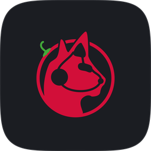
</p>

<h1 align="center">LYNX SHARE</h1>

<p align="center"><strong>A lightweight DAW with three layouts in one program: FL Studio-style patterns, Ableton Live-style clip launching and a simple one-window mode.</strong><br>
Free and open source, for Windows, macOS and Linux. Opens your FL Studio, Ableton Live and FL Studio Mobile projects.</p>

<p align="center">
  <a href="https://github.com/Ka1-S/LYNX-SHARE/releases"></a>
  <a href="https://apps.microsoft.com/detail/9NQRFBFDCX6N"></a>
  <a href="https://discord.gg/XHKkbtbkY"></a>
  <br>
  <a href="https://github.com/Ka1-S/LYNX-SHARE/releases"></a>
  <a href="https://github.com/Ka1-S/LYNX-SHARE/stargazers"></a>
  <a href="https://ko-fi.com/lynxshare"></a>
</p>

<p align="center">
  <a href="https://lynx-share.com"><strong>Website</strong></a> ·
  <a href="https://github.com/Ka1-S/LYNX-SHARE/releases"><strong>Download</strong></a> ·
  <a href="https://lynx-share.com/wiki/getting-started/">Getting started</a> ·
  <a href="#features">Features</a> ·
  <a href="#opens-your-projects">Your projects</a> ·
  <a href="#status-alpha">Status</a> ·
  <a href="https://discord.gg/XHKkbtbkY">Discord</a> ·
  <a href="#building">Build from source</a>
</p>

<p align="center">
  <a href="https://github.com/Ka1-S/LYNX-SHARE/actions/workflows/tests.yml"></a>
  
  
  
  <a href="LICENSE"></a>
</p>

<p align="center">
  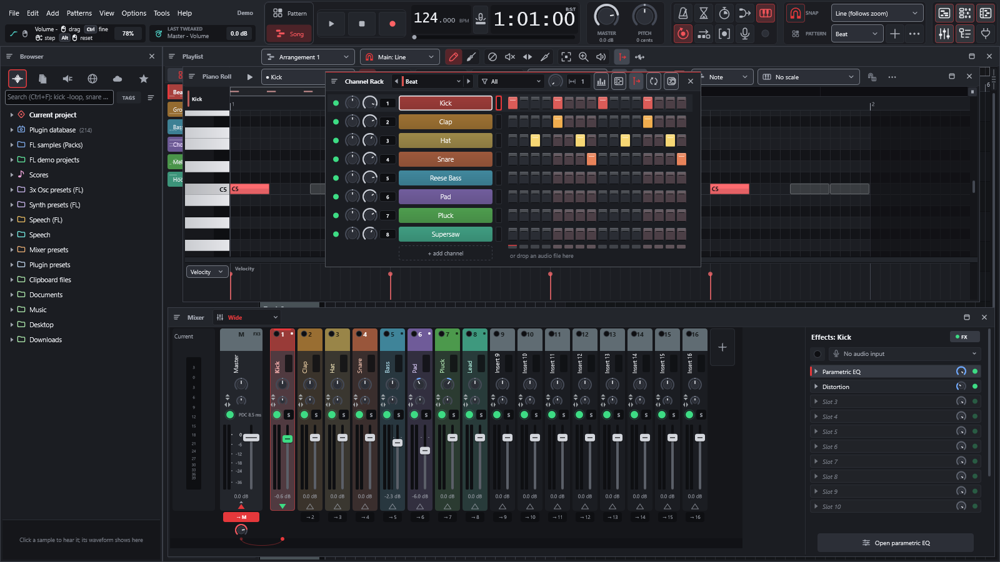
  <br><sub>LYNX SHARE's own demo project: Browser, Playlist, Piano Roll, Channel Rack and Mixer.</sub>
</p>

---

## What is LYNX SHARE?

LYNX SHARE is a free, open-source digital audio workstation with three layouts in one program. You can switch
between them at any time in *View › Layout style*; the project stays the same, only the windows change.

1. **The Pattern layout** (the default, the FL Studio workflow): you build patterns in the **Channel Rack** and
   **Piano Roll**, arrange them in the **Playlist** and mix in the **Mixer**, with the windows and shortcuts where you
   expect them.
2. **The Clip-launch layout**, in the style of Ableton Live: a grid of clips and scenes to launch, a Session mixer
   under it, and a Clip View and Device View for the selected clip and track. Live sets open with their Session clips
   in the grid.
3. **The Simple layout**, which mixes BandLab's approachable one-window style with the way FL Studio Mobile works:
   tracks and a timeline in one window, loops and pads, a drum machine and quick recording. FL Studio Mobile projects
   (`.flm`) open in it.

It opens FL Studio (`.flp`), Ableton Live (`.als`), FL Studio Mobile (`.flm`), DAWproject (`.dawproject`), GarageBand
(`.band`) and BandLab (`.blx`) projects, zipped FL Studio projects and tracker modules (`.mod`, `.xm`, `.s3m`, `.it`),
and exports `.flp`, `.als`, `.dawproject` and `.flm` back, so your work is not locked in. It runs on Windows, macOS and
Linux (x86_64 and arm64), works fully offline, is written from scratch in C++20 with JUCE 8, is licensed under the
AGPL-3.0, and is still an **alpha**.

**It's for you if you…**

- know FL Studio and want a free, open-source DAW that works the same way, on Windows, macOS or Linux;
- like to launch clips and scenes the way Ableton Live does, and want that next to patterns in the same program;
- move projects between FL Studio, FL Studio Mobile, Ableton Live and other DAWs, or collaborate with people who use them;
- are making your first song, maybe coming from BandLab, FL Studio Mobile or GarageBand, and want one simple window to start in;
- have a modest computer (or a Raspberry Pi) and want a DAW that stays light.

## Why LYNX SHARE

| | |
|---|---|
| 🎹 **The FL Studio workflow** | Channel Rack, Piano Roll, Playlist with several arrangements, and a Mixer with up to 500 inserts, sends and sidechain. The default layout, never watered down. |
| 📂 **Your projects come with you** | Opens `.flp` (also zipped), `.als` (Live 11 and 12), `.flm`, `.dawproject`, GarageBand `.band`, BandLab `.blx` and tracker modules (`.mod`, `.xm`, `.s3m`, `.it`); exports `.flp`, `.als`, `.dawproject` and `.flm`. FL Studio's native plugins play on LYNX SHARE's own engines, so a project that uses them plays without FL Studio installed. |
| 🎛️ **Three layouts, one program** | The Pattern layout by default, a Clip-launch layout in the style of Ableton Live, and a Simple layout that mixes BandLab's one-window style with FL Studio Mobile's. The first start asks where you are coming from and picks one; switch any time in *View › Layout style*. |
| 🤝 **Make music together** | Send a project to a friend as one file, or work on it live with up to three other people, end-to-end encrypted. |
| ⚡ **Lightweight** | A lock-free engine that spreads channels and mixer tracks across CPU cores, skips idle channels, renders ahead what you are not playing live and streams long audio from disk. Measured on one Windows PC, while FL's *Thief* demo plays LYNX SHARE 0.1.31 uses 34.4 % of one CPU core and 564 MB of memory (FL Studio 2026: 905 MB), and opens it in 4.3 s (FL Studio: 7.1 s) ([0.1.31 notes](https://github.com/Ka1-S/LYNX-SHARE/releases/tag/v0.1.31-alpha)). |
| 🔒 **Free, private, clean-room** | No price, no account, no subscription, no telemetry, and nothing goes online before you say so. Every behaviour was studied from the outside and written from scratch: no Image-Line or Ableton code is in it. |

## Features

### The Pattern layout: the FL Studio workflow (default)

<table>
<tr>
<td width="50%" valign="top">
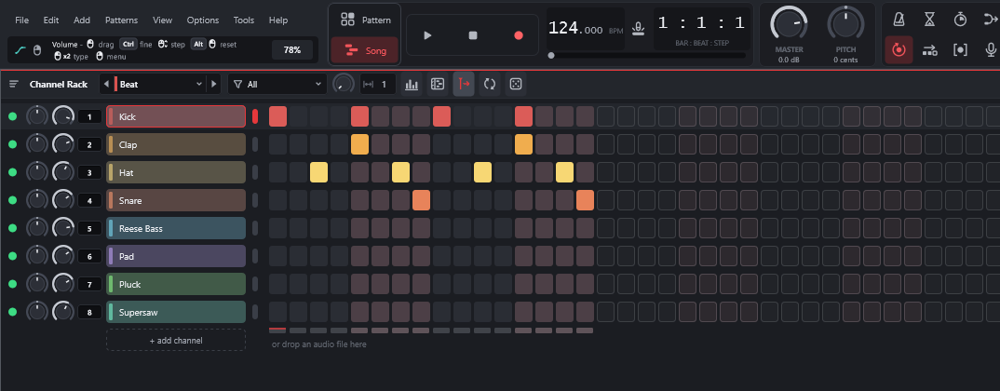

**Channel Rack.** A step sequencer with per-channel volume, pan, mute and solo, swing, multiple patterns, cut groups,
an arpeggiator, layer channels and the computer keyboard as a piano. Automation clips show as rows, as in FL Studio;
a channel can be frozen to audio, or deactivated so its instrument is unloaded until you need it.

</td>
<td width="50%" valign="top">
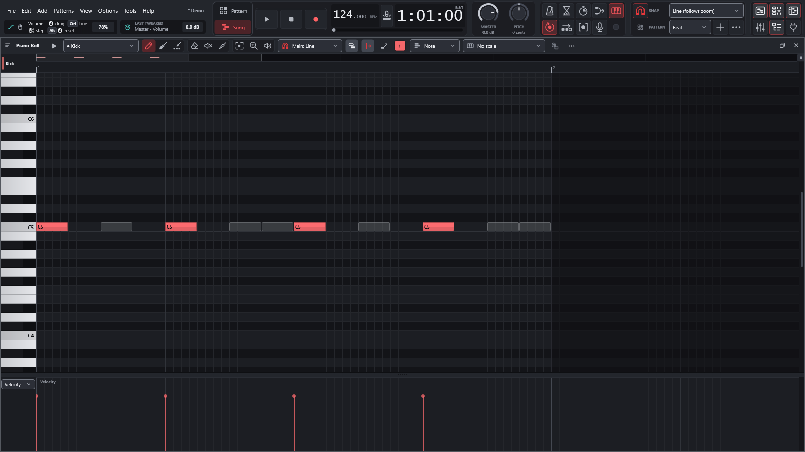

**Piano Roll.** Snap, chords and scales, key markers that change the key along the song, a *Scale degree chord*
stamp, note colours and groups, slide and porta notes, quantize, strum and arpeggiate tools, velocity, pan and pitch
lanes (optionally up to five stacked at once), ghost notes, and MIDI import and export.

</td>
</tr>
<tr>
<td width="50%" valign="top">
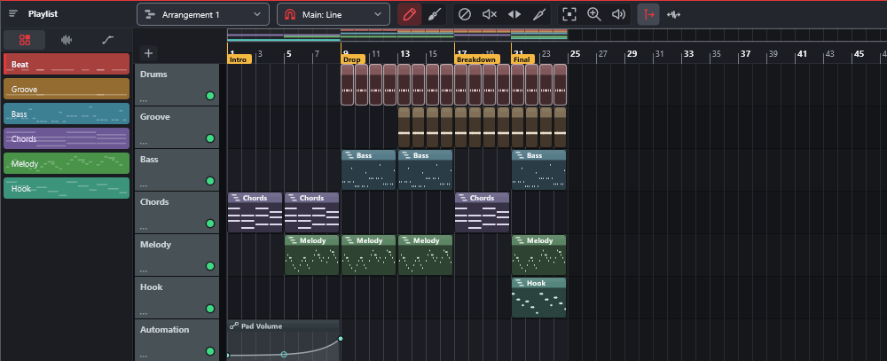

**Playlist.** Pattern, audio, automation and video clips on tracks, several arrangements per project, markers, time
selection and FL's clip menu (split, chop, merge, reverse, fit to tempo and more). An optional *Sections lane* moves,
copies and repeats whole song parts; an instrument track can give each clip its own notes (*Clips own their notes*);
and, as LYNX extras, tracks can be hidden, or deactivated to free CPU and memory.

</td>
<td width="50%" valign="top">
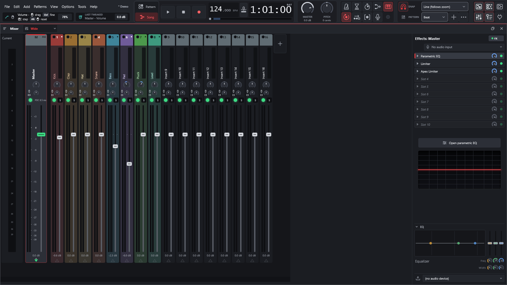

**Mixer.** Up to 500 inserts with 10 effect slots each, sends, sidechain, a built-in EQ per track, VCA faders and
groups, delay compensation and smart disable, a loudness meter, Edison on any slot, ARA plugins on an insert, and any
insert to any hardware output.

</td>
</tr>
</table>

- **Tracker:** *View › Tracker* (Shift+F7), or *Edit in tracker* in a channel's menu, shows a pattern's notes as rows
  and channels, the tracker way; it edits the same notes as the Piano Roll.
- **Audio clips:** warp markers and Auto-warp, fades, take lanes and comping, and FL Studio's audio clip menu.
- **Track versions** (a LYNX extra): named alternate versions of a track's clips, automation lanes and insert effects,
  switched from the track menu.
- **FL Studio's details:** the mouse gestures, the tool shortcuts, Remote control settings (*Link to controller...*),
  multi-level undo (Ctrl+Z, as in FL 2026), the Current mixer track and the hint bar work the way they do in FL Studio.

### The Clip-launch layout, in the style of Ableton Live

<p align="center">
  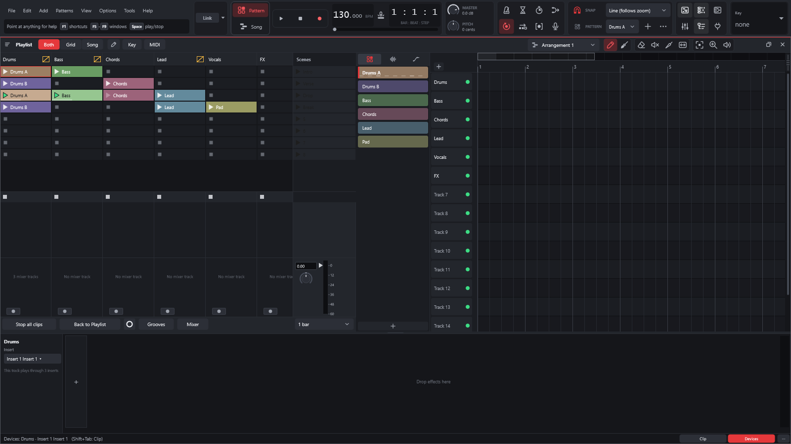
</p>

*View › Layout style › Clip-launch layout* adds an Ableton Live-style clip grid next to the arrangement: tracks are
columns, scenes are rows. Clips have launch modes, quantisation, legato, loop and follow actions, and a selected clip
opens in a Clip View with Live 12's MIDI tools. Under the grid there is a Session mixer with return tracks, sends, a
crossfader and Live's Solo / Cue (a Cue Out for your headphones). The Device View shows instrument, audio-effect and
MIDI-effect racks with their chains inline, and a Macro Map mode assigns any device parameter to a macro. There is
also a Drum Rack, Draw Mode, MIDI / Key Map Modes, Live's Freeze Track and Bounce, clip envelopes, and **Ableton
Link** to play in sync with Live and other Link apps. Live sets bring their Session clips and scenes straight into the
grid. The Pattern layout stays the default, and nothing is taken away from it.

### The Simple layout, in the style of BandLab and FL Studio Mobile

*View › Layout style › Simple layout* mixes BandLab's approachable one-window style with the way FL Studio Mobile
works: the tracks and the timeline in one window, loops and pads, and quick recording. FL Studio Mobile projects
(`.flm`) open in it too.

- Add a voice, an instrument, a 16-pad sampler or a starter beat in one click, or bring in a folder of stems and MIDI
  from another app.
- Program a beat in the Drum Machine, browse loops that follow the song's key, play chords on a Chord pad, and tune up
  with the tuner.
- Shape each track with one-knob effects, Reverb and Echo sends, and *Duck under...*, which dips a track under another
  one (the bass under the drums, for example).
- Mark the song's parts (intro, verse, chorus) as sections, change the time signature mid-song, and save the song as a
  file from the Finish dock.
- *Make my first song* walks you through it step by step.

<p align="center">
  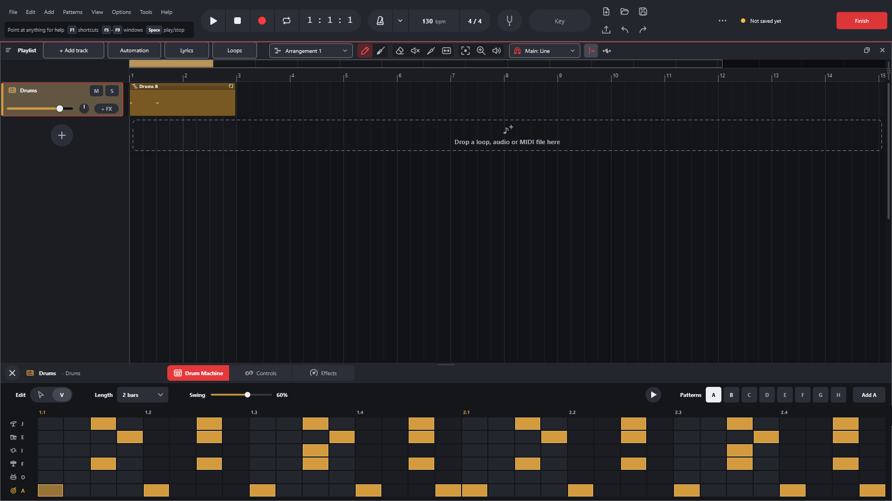
  <br><sub>The Simple layout: a drum track and its BandLab-style Drum Machine.</sub>
</p>

### Instruments and effects

<table>
<tr>
<td width="50%" valign="top">
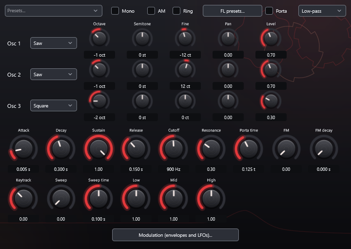

**Instruments.** A three-oscillator synth, a sampler with zones, slices, time-stretch and disk streaming, a SoundFont
player, drums, a Drum Rack, Slicex, FPC and DirectWave with FL Studio's editors, Helix (a wavetable synth), Tetra (a
4-operator FM synth), **LYNX Model** (physical models of marimba, vibraphone, xylophone, glockenspiel, tubular bells
and kalimba), and engines for most of FL Studio's native synths.

</td>
<td width="50%" valign="top">
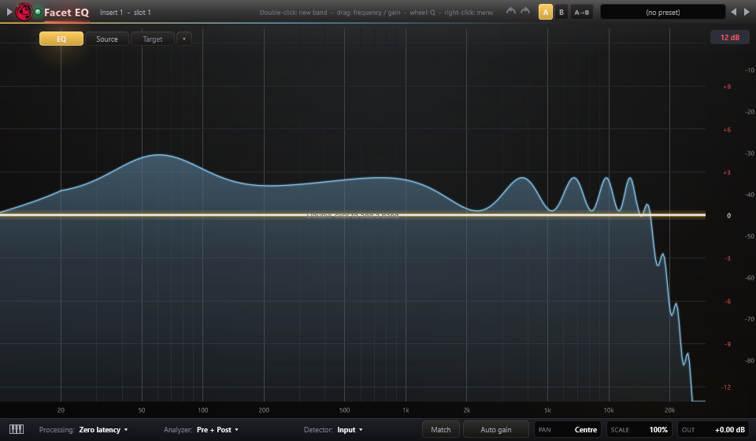

**Effects.** EQs, compressors, limiters, gates, de-essers, channel strips, reverbs, delays, modulation, saturation,
pitch correction (LYNX Tune), a vocoder, a denoiser, Edison (the audio editor) on any mixer slot, and Patcher for
building your own chains. Stand-ins for widely used third-party plugins take over when a project needs one you don't
have ([below](#inspired-by-the-classics)).

</td>
</tr>
</table>

Every one of them is listed, with a picture of its editor, in the
[catalogue of instruments and effects](https://lynx-share.com/instruments-and-effects/).

### Audio editing, chords and sound design

<table>
<tr>
<td width="50%" valign="top">
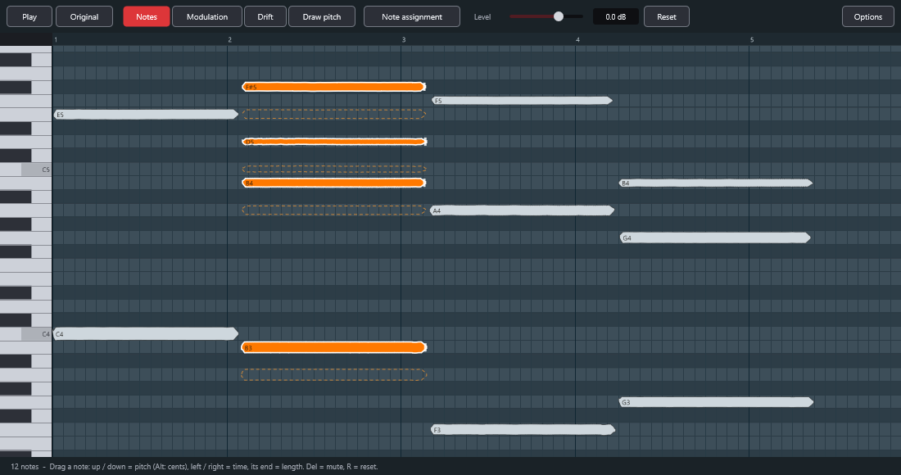

**Polyphonic note editor.** *Edit notes (polyphonic)* in an audio clip's menu finds the single notes inside chords
and mixes: move, retune, stretch or mute one of them, shape its modulation and drift, and hear it while you drag.

</td>
<td width="50%" valign="top">
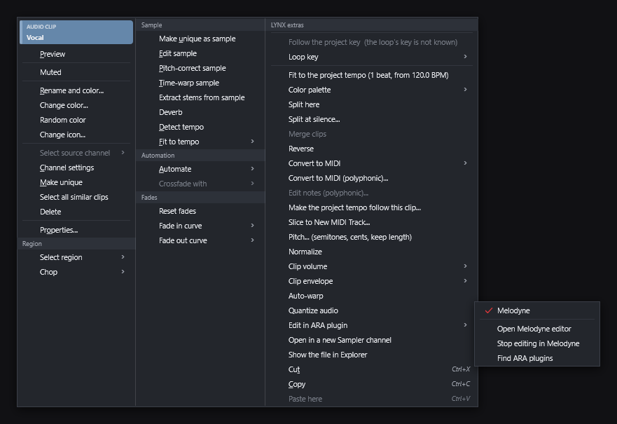

**ARA 2 plugins.** *Edit in ARA plugin* (clip menu › LYNX extras) opens an audio clip in Melodyne or another ARA 2
plugin, which edits it in place, in time with the project and its tempo map. An ARA plugin can also sit on a mixer
insert and edit every clip routed there.

</td>
</tr>
<tr>
<td width="50%" valign="top">
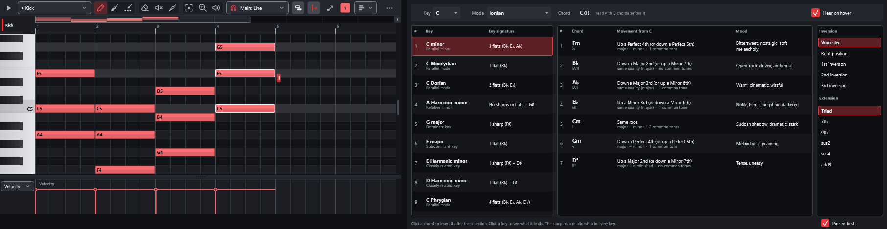

**Chord helper.** *Tools › Chord helper* in the Piano Roll reads the selected chord and suggests related keys and
borrowed chords, with how each one moves and feels; hear one on hover, click it to insert it, and pin your favourites.

</td>
<td width="50%" valign="top">
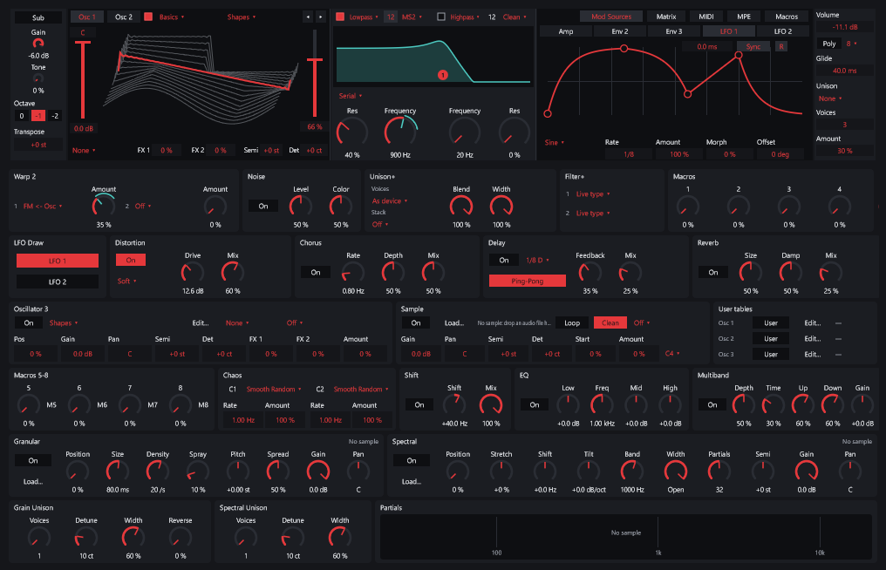

**Helix and Helix+.** Helix, the wavetable synth, gets a Helix+ strip in its channel window: a third oscillator,
sample, granular and spectral layers, your own wavetables (drawn, or made from audio), more warp modes, unison and
filter types, eight macros, drawn LFOs, chaos sources and a rack of effects.

</td>
</tr>
</table>

- **Chord lane** (a LYNX extra in every layout): the song's chords on a lane under the ruler. Draw them, pick them
  from the key's chords, or detect them from the notes or an audio clip; channels can follow them, and the Piano Roll
  can light the current chord's notes.
- **Smart Tempo:** *Make the project tempo follow this clip...* puts a tempo marker on each bar of a recording played
  without a click, so the bars follow the performance and the audio stays exactly as recorded.
- Audio clips also convert to MIDI (polyphonic too), stems can be extracted from a sample, and Newtone corrects vocals.

### Song lanes, tracker and more

<table>
<tr>
<td width="50%" valign="top">
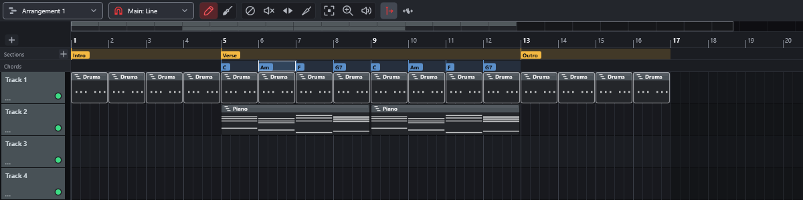

**Sections and Chord lanes.** The song's parts on a Sections lane that moves, copies and repeats them as a whole, and its chords on a Chord lane under the ruler.

</td>
<td width="50%" valign="top">
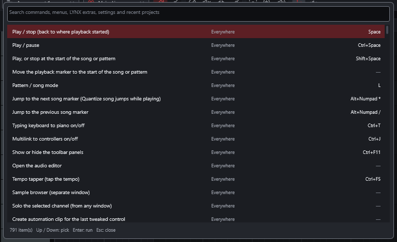

**Search actions.** `?` or Ctrl+Shift+Y lists every command, menu item, LYNX extra and Settings page; type a few letters and press Enter.

</td>
</tr>
<tr>
<td width="50%" valign="top">
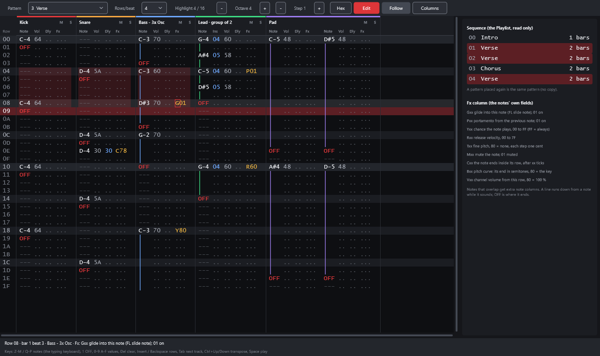

**Tracker.** *View › Windows and tools › Tracker* (Shift+F7) shows a pattern's notes the tracker way, in step with the Piano Roll; tracker modules open too.

</td>
<td width="50%" valign="top">
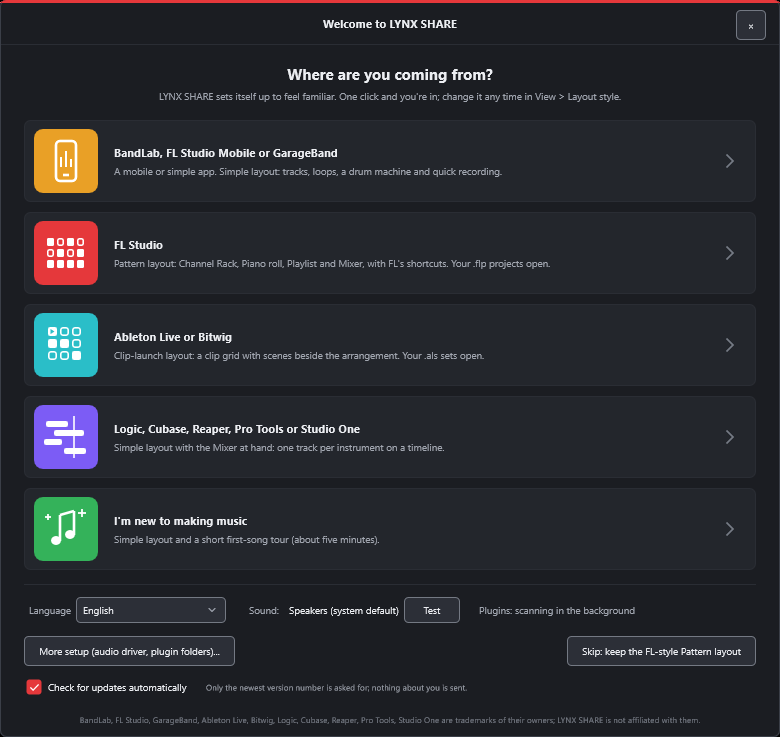

**Welcome.** The first start asks where you are coming from and opens the matching layout.

</td>
</tr>
<tr>
<td width="50%" valign="top">
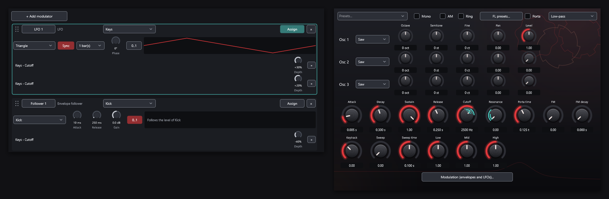

**Modulators.** LFO, envelope follower, ADSR, steps, random, macro, keytrack and velocity move any knob around its own value; a ring shows the movement.

</td>
<td width="50%" valign="top">
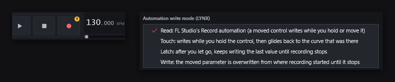

**Automation write modes.** Read (FL Studio's Record automation), Touch, Latch and Write; the record button shows the mode.

</td>
</tr>
<tr>
<td width="50%" valign="top">
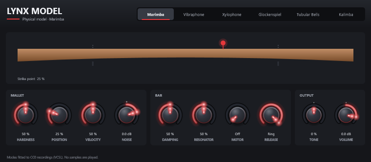

**LYNX Model.** Physical models of marimba, vibraphone, xylophone, glockenspiel, tubular bells and kalimba.

</td>
<td width="50%" valign="top">
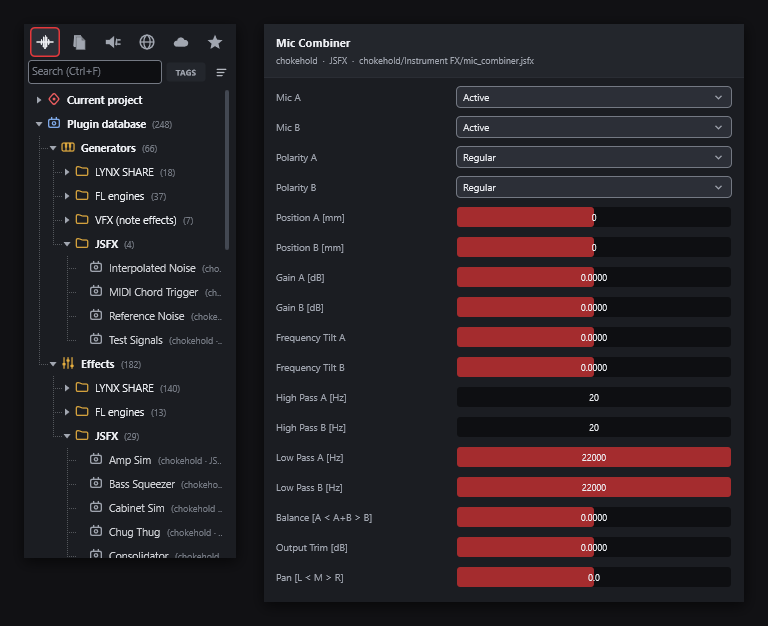

**JSFX.** REAPER's JSFX effects and instruments run on every system, with free scripts included.

</td>
</tr>
</table>

### Automation and modulation

- **Automation clips** for any knob or fader of a channel, the mixer, an effect or a plugin, with points and all 13 of
  FL Studio's curve modes; optional automation lanes under tracks; record automation live.
- **Write modes:** Read (FL Studio's Record automation, the default), Touch, Latch and Write, as LYNX extras.
- **Capture automation:** moved a knob while playing without recording? *Capture automation* turns the last moves
  into automation afterwards.
- **Modulators:** an LFO, an envelope follower, an ADSR envelope, steps, a random source, a macro, keytrack or
  velocity can move any knob around its own value, also on third-party plugins; drag a modulator onto a knob or use
  *Modulate with* in the knob's menu, and a ring on the knob shows the movement.
- **MIDI controllers:** link any parameter, or use the profiles for common controllers (Mackie Control, Launchkey,
  APC Key 25, KeyLab Essential, nanoKONTROL2). MPE controllers play each note with its own bend, timbre and pressure.

### Recording

Notes from the computer keyboard or a MIDI keyboard (MPE too), and audio with punch in / out, loop takes and comping.
MIDI Out channels play hardware synths, and a hardware insert brings outboard gear into the mixer with delay
compensation.

### Working in LYNX SHARE

- **A welcome that fits you:** the first start asks where you are coming from (BandLab, FL Studio Mobile or GarageBand;
  FL Studio; Ableton Live or Bitwig; Logic, Cubase, Reaper, Pro Tools or Studio One; or new to music) and sets up the
  matching layout, with three first things to try. Later starts open on a start page with your recent projects and the
  templates.
- **Find anything:** *Search actions...* (`?` or Ctrl+Shift+Y) finds any command, menu item, LYNX extra or Settings
  page by name; the Settings window has its own search (Ctrl+F).
- **More than one project:** *File › Open in new window* opens a second project beside the first, and notes, clips,
  patterns, channels and mixer settings copy and paste between them.
- **Safe by default:** undo on every edit with an undo history, autosave and project versions, *Save a copy for an
  older LYNX...*, and *Collect all and save*, which copies every sample the project uses next to it.
- **Your look and language:** themes, automatic colours and icons by track name, and the interface in 15 languages.

### Import and export

- **Open:** `.lynx`, `.flp` (also FL's zipped loop packages), `.als`, `.flm`, `.dawproject`, GarageBand `.band`,
  BandLab `.blx`, tracker modules and MIDI files, plus DirectWave, GigaStudio and Kontakt `.ncw` instruments and
  samples. Details in [Opens your projects](#opens-your-projects).
- **Export audio:** WAV (16/24/32-bit float), MP3, FLAC, OGG, AIFF (16/24-bit) and M4A (AAC, with the system's encoder
  on Windows and macOS): the song, one pattern, one file per marker or section, or stems (all mixer stems from one
  render).
- **Export projects:** FL Studio (`.flp`, or a zipped loop package with every sample), Ableton Live 11 / 12 (`.als`),
  DAWproject (`.dawproject`), FL Studio Mobile (`.flm`, a copy) and MIDI.
- **Bring in parts of another project:** *File › Import › Tracks from another project...* takes the tracks you tick
  from any project LYNX SHARE opens, with their clips and, if you want, their mixer inserts, effects and automation.

### Online Sessions

*File › Online session* sends a project as one `.lynxpack` file, with its samples, or starts a live session for up to
four people: everyone edits the same project at once, with a chat, end-to-end encryption, and optional plugin sharing
for guests who don't have the host's plugins. The host can let a guest only listen, or remove them from the session.

<p align="center">
  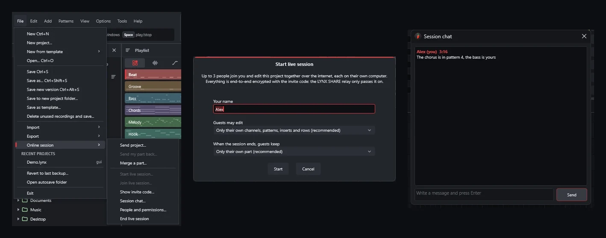
  <br><sub>Online sessions: the menu, starting a live session, and the session chat.</sub>
</p>

### Third-party plugins and the LYNX plugin pack

- **Hosts** VST3 and CLAP on every system, plus Audio Units on macOS, LV2 on Linux and VST2 on Windows and Linux;
  32-bit plugins on Windows run through a bridge.
- **JSFX scripts**, REAPER's effect and instrument format, run on every system, in slots and as instruments, with their
  sliders in LYNX SHARE's own panel; 31 free scripts (MIT) come with it, and your own folders or REAPER's Effects folder
  are found too.
- **Crash-safe:** plugin scanning always runs in separate processes, and a plugin can run in its own process too, so
  one that crashes goes silent instead of taking your project down. A performance monitor shows what each plugin costs.
- **The plugin pack:** 39 of LYNX SHARE's own effects and instruments, from Facet EQ to LYNX Model, also work in other
  DAWs: every one in a single CLAP, a short list also as VST3 and, on Linux, LV2. It is an optional `LYNX-Plugins` download for Windows,
  macOS and Linux (on Windows take the `.7z`, about 20 MB; the `.zip` has the same files); see
  [`docs/PLUGINS-PACK.md`](docs/PLUGINS-PACK.md).

### Performance

- A lock-free, multi-core engine: channels and mixer tracks are processed in parallel, idle channels are skipped,
  parts you are not playing live are rendered a little ahead, and long audio streams from disk.
- *Safe overloads* (on by default, as in FL Studio) keeps the interface responsive when the CPU runs out; deactivating
  the tracks and channels you are not using frees their CPU and memory.
- Every release is measured against FL Studio on the same PC, and the automated tests check the engine's and the
  interface's cost on every change. The latest numbers are in the [table above](#why-lynx-share).

### Platforms

| | Windows 10 / 11 | macOS 11+ (Apple Silicon and Intel) | Linux x86_64 and arm64 |
|---|---|---|---|
| **Plugin formats** | VST3, CLAP, VST2 (32-bit plugins through a bridge), JSFX | VST3, CLAP, Audio Units, JSFX | VST3, CLAP, LV2, VST2, JSFX |
| **Audio drivers** | WASAPI, DirectSound, ASIO | Core Audio | PipeWire, JACK, ALSA |
| **Settings folder** | `%APPDATA%\LYNX` | `~/Library/Application Support/LYNX` | `~/.config/LYNX` |

Linux arm64 runs on a Raspberry Pi 4 / 5 with a 64-bit OS and on other arm64 machines.

### Offline and private

- LYNX SHARE starts and works fully offline. It never connects anywhere before the first-start window is answered,
  and that window asks whether to check for updates (only the newest version number is asked for).
- No account and no telemetry. Crash reports are opt-in: LYNX SHARE asks before sending one
  ([details](#code-signing-policy)).
- For sandboxes and packagers, `LYNX_OFFLINE=1` or `--offline` turns off every network connection of LYNX's own.
- Every connection the program can make, and why, is listed in [`PRIVACY.md`](PRIVACY.md).

## Opens your projects

*File › Open* (or a double-click in the Browser) takes `.lynx`, `.flp`, `.als`, `.flm`, `.dawproject`, GarageBand
`.band`, BandLab `.blx`, tracker modules (`.mod`, `.xm`, `.s3m`, `.it`), MIDI files and zipped projects (FL Studio's
zipped loop packages, or a project exported with its samples), which are unpacked into a folder of their own. Missing samples
are listed in the Missing files window, and *Help › Last project import report* tells you what was converted,
approximated or left out. The original file is never changed: saving writes a `.lynx` project.

| Format | Open | Export | In short |
|---|:---:|:---:|---|
| **FL Studio** `.flp`, zipped `.zip` | ✅ | ✅ | Channels, samples, patterns, every arrangement, automation, the mixer and native plugins with their settings. Export as `.flp` or as a zipped loop package with every sample. |
| **Ableton Live** `.als` (Live 11 and 12) | ✅ | ✅ | Tracks, clips, warp markers, groups, returns, automation, racks and many of Live's devices. Session clips land in the clip grid. |
| **DAWproject** `.dawproject` (Bitwig, Studio One, Cubase and other apps) | ✅ | ✅ | Tracks, folders, clips, notes, audio with its warp markers, automation, tempo and markers, the mixer with sends, and VST3 / VST2 / CLAP plugins with their state. The clip grid, other arrangements and some per-note details stay behind (listed in the report). |
| **FL Studio Mobile** `.flm` | ✅ partial | ✅ a copy, with losses listed | Arrangement, samples, drum kits, several instruments and effects, automation and chord sets. Export is *File › Save a copy as FL Studio Mobile project (.flm)...*; see below. |
| **GarageBand** `.band` (GarageBand 10, GarageBand for iOS) | ✅ partial | — | Tracks, MIDI and audio regions, tempo, key, levels, pan and mute, as Simple-layout tracks. |
| **BandLab** `.blx` (BandLab project downloaded by Cakewalk / Sonar) | ✅ partial | — | Tracks, MIDI and audio regions with their loops, tempo, key, levels, pan, mute, volume and pan automation and the common effects, as Simple-layout tracks. |
| **Tracker modules** `.mod` `.xm` `.s3m` `.it` (ProTracker, FastTracker 2, Scream Tracker 3, Impulse Tracker) | ✅ partial | — | Instruments as Sampler channels with their samples, patterns, the order list as the Playlist, speed and tempo, note volume, pan, delay and cut. Volume and pan changes become the channel's events (MOD and XM), and slides, vibrato, arpeggios and pitch envelopes become the notes' pitch curves; what is left out is counted in the report. The built-in Tracker (*View › Tracker*) edits the notes the tracker way. |
| **MIDI** `.mid` | ✅ | ✅ | Notes, into or out of the Piano Roll or the whole song. |
| **LYNX SHARE** `.lynx` | ✅ | ✅ | The native format (JSON), with autosave. *File › Save a copy for an older LYNX...* writes a copy that 0.1.30, 0.1.28 or 0.1.27 can open, and lists what that release loses. |

Instruments and samples of other samplers open too: DirectWave programs and banks (`.dwp`, `.dwb`), GigaStudio `.gig`
instruments (as DirectWave channels) and Kontakt's `.ncw` samples. Kontakt `.nki` instruments need Kontakt itself as a
plugin; protected libraries are never decrypted.

<details>
<summary><strong>FL Studio (<code>.flp</code>): what comes in and what goes back</strong></summary>

- **Structure:** channels, samples (including the Ogg Vorbis and WavPack files shipped with FL), patterns, slide and porta notes, every arrangement, markers, time-signature changes, automation and controller links.
- **Mixer:** routing, levels, sidechains, track EQ and native effects with their saved settings.
- **FL Studio's native plugins** play on LYNX SHARE's own engines, written from scratch and checked against the originals; most are exact or near-exact (see [Built-in plugins](#built-in-instruments-and-effects)). Wave data and factory sounds some of them need are read from *your* FL Studio installation, never shipped with LYNX SHARE.
- **Third-party plugins** inside the Fruity Wrapper are swapped for the same installed plugin, preset included.
- **Not opened:** FLEX packs are encrypted and are never opened; such a channel gets a built-in synth patch instead.
- **Export:** *File › Export › FL Studio project...* writes an FL Studio 2026 `.flp` (or a zip with the samples). What FL Studio has itself goes over as FL's own data; LYNX-only instruments and effects are rendered to audio first or replaced by the nearest FL plugin, and the report says which.

If FL Studio is installed on the same computer, `.flp` projects use the very plugin files FL uses and find samples in
FL's folders ([details](docs/FL_INTEGRATION.md)).

</details>

<details>
<summary><strong>Ableton Live (<code>.als</code>): what comes in and what goes back</strong></summary>

- **Import:** MIDI tracks become channels with their patterns, audio tracks become audio clips (warp markers, warp modes with their settings, clip grooves and clip envelopes kept), groups and returns become mixer inserts and sends, plus tempo, time signature, locators, mixer levels and their automation. Session clips and scenes go into the clip grid with their launch settings and follow actions. Third-party VST2 and VST3 plugins keep their state and automation. Instrument and Audio Effect Racks come in with their chains and macros, and a Drum Rack becomes LYNX SHARE's Drum Rack.
- **Live's own devices** become LYNX SHARE's, with their settings and automation: EQ Eight, EQ Three, Channel EQ, Compressor, Glue Compressor, Multiband Dynamics, Limiter, Gate, Utility, Reverb, Delay, Echo, Auto Filter, Saturator, Overdrive, Chorus-Ensemble, Redux, Hybrid Reverb, Roar, Grain Delay, Auto Pan and Drum Buss (on Anvil Bus); Simpler, Sampler, Drift and Operator (without FM); the Arpeggiator, Pitch, Velocity, Chord and Note Length are written into the notes. Live's device and rack presets (.adv / .adg) can be dropped on a mixer slot. Other devices are dropped and listed in the report.
- **Export:** *File › Export › Ableton Live set (.als)...* writes a set for Live 12 or Live 11 with the samples collected: tracks, clips, notes, warp markers, groups, returns, mixer, sends, automation, locators, racks, Drum Racks and the clip grid as Session view. Third-party plugins go over with their state; LYNX SHARE's own instruments and effects are not converted yet (the export report lists them).

More in the [format notes](docs/analise/ALS_FORMAT.md).

</details>

<details>
<summary><strong>FL Studio Mobile (<code>.flm</code>): import partial, export as a copy</strong></summary>

Tempo, time signature and the arrangement (note, drum and audio lanes), samples, drum kits with each pad's settings,
DW Sampler and DirectWave programs, the Slicer, the MiniSynth, Transistor Bass, 3x Osc, GMSynth and SuperSaw
instruments, FL Studio Mobile's effects, the mixer's levels, panning and routing, automation, chord sets and the key
locker. Point *Settings › Files › FL Studio Mobile resources* at your own copy of the app's Resources folder and the
factory sounds play. FL Studio Mobile Rack channels in an `.flp` play on the same engines. Other instruments play LYNX SHARE's built-in synth for now, and anything not converted is listed in the import
report. More in the [format notes](docs/analise/FLM_FORMAT.md).

*File › Save a copy as FL Studio Mobile project (.flm)...* writes an `.flm` and copies the samples into a `<name> Samples`
folder beside it. Before it saves, a window lists what the copy loses, as *Save a copy for an older LYNX...* does. The
`.flm` keeps the notes and patterns (FL Studio Mobile has one pattern per track), tempo, beats per bar, key and chord set,
the mixer's levels, panning, mute, solo and sends to buses, FL Studio Mobile's own instruments (MiniSynth, SuperSaw,
GMSynth and Transistor Bass, and FL Studio's MiniSynth and Transistor Bass), drum samplers as a drum kit, Layers as a
rack with several instruments, every Pocket (FLM) effect with its mix, and audio clips with their level, pan, pitch and
reverse. It also writes the DW Sampler (with its zones) and 3x Osc, and automation clips of mixer level and pan, of the
Pocket (FLM) effects and of the DW Sampler's and GMSynth's own values. Other instruments (for now including FL Studio
Mobile's Slicer and SoundFont Player) keep their notes on FL Studio Mobile's MiniSynth, and effects without an FLM module
and automation of other targets, such as the synths' own knobs and third-party plugins, are left out; all of it is listed.

</details>

<details>
<summary><strong>GarageBand (<code>.band</code>): import only, partial</strong></summary>

Projects saved by GarageBand 10 for Mac or GarageBand for iOS open as Simple-layout tracks: tempo, time signature,
key, song sections (as markers), each track's level, pan and mute, MIDI regions with their notes, and audio regions
from the project's Media folder (with their trim). Open the `.band` package itself, the `projectData` file inside it,
or a zip of it. GarageBand's instruments and effects are not stored in a readable form: instrument tracks play
LYNX SHARE's built-in synth (a preset chosen by the patch name) and drum kits its built-in drums, except Sampler
instruments you made in GarageBand for iOS: their recordings are inside the project and play on a Sampler track. Smart Drums, Drummer
and pattern regions, take folders, tempo changes and Apple Loops that are not inside the project are listed in the
import report. Projects from GarageBand 6–11 (2013 and older) are not readable: save them again in GarageBand 10, or
export the tracks as audio (or MIDI) and bring the folder in with the Simple layout's *Folder...* import.

</details>

<details>
<summary><strong>BandLab (<code>.blx</code>): import only, partial</strong></summary>

A BandLab project downloaded by Cakewalk or Sonar (*Documents\BandLab\Downloads\<project>*, the `.blx` with its audio
and MIDI files beside it) opens as Simple-layout tracks: tempo, time signature, key, each track's volume, pan, mute,
volume and pan automation (as automation lanes) and its send to BandLab's shared reverb, MIDI regions with their notes
and audio regions with their offset, gain, fades, pitch and speed; looped regions repeat. BandLab's compressor, 3-band
and graphic EQs, reverbs, delays, chorus, distortions and limiters come over on LYNX SHARE's effects; other pedals,
the Mastering preset, BandLab's instrument sounds and sampler kits are listed in the import report (instrument tracks
play LYNX SHARE's built-in synth and drums). Open the `.blx`, or pick its folder with the Simple layout's *Folder...*
import. Without Cakewalk, BandLab's *Download › Tracks* stems and MIDI come in with the same *Folder...* import. The
reader follows BandLab's project data as BandLab's own apps write it and was tested on made-up projects only: if a `.blx`
of yours doesn't open as it should, please open an issue.

</details>

## Built-in instruments and effects

LYNX SHARE's engines for FL Studio's native plugins are clean-room re-implementations, each compared against the
original. The plugins FL Studio users reach for most are all at *Exact* or *Near-exact* quality:

| LYNX SHARE engine | Compatible with | Status |
|---|---|---|
| 3x Osc engine | 3x Osc | Exact |
| FL Keys engine | FL Keys | Exact |
| Gross Beat | Gross Beat | Exact |
| Fruity Delay 3 | Fruity Delay 3 | Exact |
| Reeverb 2 | Fruity Reeverb 2 | Exact |
| Fruity Compressor | Fruity Compressor | Exact |
| Fruity Limiter | Fruity Limiter | Near-exact |
| Parametric EQ | Fruity Parametric EQ 2 | Near-exact |
| Soundgoodizer | Soundgoodizer | Near-exact |
| Maximus | Maximus | Near-exact |

**All of them:**

| | Exact | Near-exact | Close | Approximate | Placeholder |
|---|---:|---:|---:|---:|---:|
| **Generators** (3x Osc, DX10, Sytrus, Harmor, FL Keys, DirectWave, …) | 12 | 10 | 7 | 1 | 2 |
| **Effects** (Parametric EQ 2, Limiter, Reeverb 2, Delay 3, Gross Beat, Love Philter, …) | 34 | 10 | 1 | 8 | 1 |

*Exact* means bit-identical to the original in every case tested; *near-exact*, any difference is below about −100 dB;
*close*, the same algorithm within −60 dB. What each engine does and what it still lacks is in
[`docs/PLUGINS.md`](docs/PLUGINS.md). Plugin names are Image-Line's trademarks, used only to describe compatibility.

LYNX SHARE's own effects and instruments (39 of them, from Facet EQ to LYNX Model) are also available as plugins for
other DAWs in the optional `LYNX-Plugins` download ([above](#third-party-plugins-and-the-lynx-plugin-pack)).

<!-- inspired:begin (generated by scripts/gen-inspired.py) -->
## Inspired by the classics

LYNX SHARE ships **native** plugins inspired by the third-party plugins producers use most, next to its clean-room FL Studio natives. 28 dedicated LYNX SHARE engines are in, more are being built, and a project that uses one of the 124 originals below **opens with the LYNX SHARE equivalent** when the original is not installed (its settings are kept and come back once it is; see [PLUGIN_FALLBACK.md](docs/PLUGIN_FALLBACK.md)).

| Vendor | Inspired by → LYNX SHARE plugin |
|---|---|
| **FabFilter** | Timeless 3 → **Echoform** · Pro-L 2 → **Apex Limiter** · Pro-C 2 / 3 → **Crest Compressor** · Pro-MB → **Prism Multiband** · Pro-G → **Sentry Gate** · Pro-Q 2 / 3 / 4 → **Facet EQ** · Pro-DS → **Hush De-esser** · Saturn → **Ember Saturator** · Pro-R 2 → LuxeVerb (stand-in) |
| **Valhalla DSP** | VintageVerb → **Epoch Verb** · Room → **Atrium** · Plate → **Foil Plate** · Supermassive → **Nebula** · Shimmer → **Halo** · FutureVerb → **Horizon** · Delay → **Echoform** · FreqEcho → **Spiral Echo** · SpaceModulator → **Orbit** · UberMod → **Lattice Mod** |
| **Antares** | Auto-Tune → **LYNX Tune** |
| **Waves** | H-Delay → **Echoform** · SuperTap → **Echoform** · CLA-2A → **Glow Leveler** · CLA-76 → **Crest Compressor** · SSLComp → **Crest Compressor** · SSL E-Channel → **Ridge Strip** · SSL G-Channel → **Ridge Strip** · S1 Imager → **Stereo Shaper** · C4 Multiband Parametric Processor → **Prism Multiband** · Scheps Omni Channel → **Ridge Strip** · Renaissance DeEsser → **Hush De-esser** · C6 Multiband Compressor → **Prism Multiband** · Vitamin → **Aether** · Abbey Road Reverb Plates → **Foil Plate** · Atlas Reverb → **Atrium** · PuigTec EQP1A → **Facet EQ** · Renaissance Equalizer (REQ) → **Facet EQ** · API 550A / 550B → **Facet EQ** · API 560 → **Facet EQ** · Q10 Equalizer → **Facet EQ** · DeEsser → **Hush De-esser** · NS1 → **Quell Denoiser** · Doubler → **Gemini Doubler** · Tune Real-Time → **LYNX Tune** · RVerb, H-Reverb, TrueVerb → Reeverb 2 (stand-in) · L1, L2, L3, L4 → Limiter (stand-in) · Renaissance Compressor → Compressor (stand-in) · CLA-76, CLA-3A, C1, SSLComp, API-2500 → Compressor (stand-in) · Renaissance Vox → Compressor (stand-in) · API-2500 → Compressor (stand-in) · Renaissance Bass → Low Lifter (stand-in) · MaxxBass → Low Lifter (stand-in) · Q10, Renaissance EQ, SSL EQ → Parametric EQ (stand-in) · Renaissance Channel (RChannel) → Compressor (stand-in) |
| **Solid State Logic** | Native Channel Strip, 4K E → **Ridge Strip** |
| **Soundtoys** | Little Plate → **Foil Plate** · EchoBoy → **Echoform** · EchoBoy Jr → **Echoform** · PrimalTap → **Echoform** · Little PrimalTap → **Echoform** · Decapitator → **Ember Saturator** · Little AlterBoy → **LYNX Tune** · PanMan → Auto-pan (stand-in) |
| **Slate Digital** | Infinity EQ → **Facet EQ** · Fresh Air → **Aether** |
| **Harrison** | 32Classic / MPC channel strips → **Ridge Strip** · De-Esser → **Hush De-esser** |
| **Complete Access (role)** | channel strips (Slate Virtual Mix Rack) → **Ridge Strip** · bus / smart compressors (SSL Bus Compressor 2, G3, VBC, sonible smart:comp, pure:comp) → **Crest Compressor** · optical levelers (Slate FG-2A, SD-3A, Custom Opto) → **Glow Leveler** · limiters (Slate FG-X 2, SSL X-Limit, sonible smart:limit, pure:limit) → **Apex Limiter** · EQs (Slate FG-73 / FG-N / FG-S / SD-PE1 / CS-EQ, SSL X-EQ 2, sonible smart:EQ) → **Facet EQ** · de-essers (SSL DeEss, Slate FG-DS 902, Eiosis E2Deesser, sonible smart:deess) → **Hush De-esser** · gates (SSL X-Gate, Slate Gate Classic / Drums, Harrison Spectral Gate) → **Sentry Gate** · three-band bus compressor (SSL G3 MultiBusComp) → **Prism Multiband** · drum gate (Slate Gate Drums) → **Sentry Gate** · reverbs (LiquidSonics Lustrous Plates / Seventh Heaven / Cinematic Rooms, Slate VerbSuite Classics, SSL FlexVerb / PlateVerb / SpringVerb, sonible smart:reverb) → **Foil Plate** · delays (SSL X-Echo / X-Delay, Slate Stellar Echo SD-201, Harrison 3D Delay) → **Echoform** · saturators (Slate Heatwave / Revival, SSL Fusion Vintage Drive / X-Saturator, Harrison Tape Saturator) → **Ember Saturator** · pitch correction (Slate MetaTune) → **LYNX Tune** · vintage compressor models (Slate FG-116 / FG-76 / FG-401 / FG-A / FG-Dynamics, SSL X-ValveComp) → Compressor (stand-in) |
| **D16 Group** | Repeater → **Echoform** |
| **Eiosis (Slate Digital)** | AirEQ (Eiosis AirEQ, Slate VM AirEQ Air / Earth) → **Facet EQ** |
| **Kilohearts** | Disperser → **Facet EQ** · kHs Haas → **Stereo Shaper** · kHs Filter → **Facet EQ** · kHs 3-Band EQ → **Facet EQ** · kHs Formant Filter → **Facet EQ** · kHs Gate → **Sentry Gate** · kHs Transient Shaper → **Strike Shaper** · kHs Delay → **Echoform** · kHs Dual Delay → **Echoform** · kHs Gain → Utility (stand-in) · kHs Channel Mixer → Utility (stand-in) · kHs Stereo → Utility (stand-in) · kHs Ladder Filter → Filter (stand-in) · kHs Nonlinear Filter → Effector (stand-in) · kHs Compressor → Compressor (stand-in) · kHs Compactor → Compressor (stand-in) · kHs Dynamics → Compressor (stand-in) · kHs Limiter → Limiter (stand-in) · kHs Clipper → Fruity Soft Clipper (stand-in) · kHs Distortion → Effector (stand-in) · Faturator → Distortion (stand-in) · kHs Bitcrush → Effector (stand-in) · kHs Frequency Shifter → Effector (stand-in) · kHs Pitch Shifter → Pitch shift (stand-in) · kHs Chorus → Effector (stand-in) · kHs Ensemble → Effector (stand-in) · kHs Phaser → Effector (stand-in) · kHs Flanger → Fruity Flanger (stand-in) · kHs Reverb → Reeverb 2 (stand-in) · kHs Tape Stop → Pocket Tape Stop (stand-in) · kHs Comb Filter → Effector (stand-in) · kHs Trance Gate → Effector (stand-in) · kHs Ring Mod → Effector (stand-in) · kHs Reverser → Effector (stand-in) · kHs Resonator → Effector (stand-in) · kHs Phase Distortion → Effector (stand-in) · kHs Shaper → Effector (stand-in) |
| **SPL** | Transient Designer → **Strike Shaper** |
| **Slate Digital (Complete Access)** | VCC Channel (console emulation) → **Kiln Channel** |
| **Solid State Logic (Complete Access)** | Drumstrip (drum channel strip) → **Shell Channel** · Guitarstrip (guitar / bass channel strip) → **Fret Channel** |
| **Image-Line FL Studio** | 76 natives at Exact / Near-exact quality: 3x Osc, FL Keys, Gross Beat, Fruity Limiter, Parametric EQ, Soundgoodizer, Maximus, Fruity Delay 3, Reeverb 2, Fruity Compressor, Epoch Verb, Nebula, Atrium, Foil Plate, Echoform, Crest Compressor, Prism Multiband, Sentry Gate … ([all of them](docs/PLUGINS.md)) |

<sub>Product and company names are trademarks of their respective owners. They are used only to describe compatibility and the role each LYNX SHARE engine plays. LYNX SHARE is not affiliated with, endorsed or sponsored by any of them and contains none of their code, presets, graphics or audio.</sub>
<!-- inspired:end -->

## Download

Get the latest build from the [releases page](https://github.com/Ka1-S/LYNX-SHARE/releases) or the
[download page](https://lynx-share.com/download/) (`<v>` is the version, e.g. `0.1.27-alpha`):

| System | File | Notes |
|---|---|---|
| **Windows** 10 / 11, 64-bit | `LYNX-<v>-setup-x64.exe` (installer) or `LYNX-<v>-windows-x64.zip` (portable) | Per-user installer, no admin rights. Also on the [Microsoft Store](https://apps.microsoft.com/detail/9NQRFBFDCX6N), which keeps it updated. |
| **macOS** 11 Big Sur or newer | `LYNX-<v>-macos-universal.dmg` | Universal: Apple Silicon and Intel. |
| **Linux** x86_64, glibc 2.35+ | `LYNX-<v>-x86_64.AppImage` or `LYNX-<v>-linux-x86_64.tar.gz` | Ubuntu 22.04+, Debian 12+, Fedora 36+, current Arch / Manjaro. |
| **Linux** arm64 (aarch64), glibc 2.35+ | `LYNX-<v>-aarch64.AppImage` or `LYNX-<v>-linux-aarch64.tar.gz` | From 0.1.31. Raspberry Pi 4 / 5 with a 64-bit OS, Ubuntu / Debian / Fedora arm64. Built and self-tested on GitHub's arm64 runners. |

Every file is built from the tagged source by GitHub Actions ([`release.yml`](.github/workflows/release.yml)) and
listed with its SHA-256 in `SHA256SUMS.txt`. Once installed, LYNX SHARE tells you when a new version is out.

<details>
<summary><strong>First launch on each system</strong></summary>

**Windows.** Run the installer, or extract the portable `.zip` and run `LYNX.exe`. The installer adds shortcuts, opens
`.lynx` projects and offers LYNX SHARE in *Open with* for `.flp` files without changing FL Studio's default. The
executable is not code-signed yet, so SmartScreen may warn the first time: choose *More info* → *Run anyway* (see
[Code signing policy](#code-signing-policy)).

**macOS.** Open the `.dmg` and drag LYNX SHARE to *Applications*. The app is not notarized by Apple yet, so the first
time right-click (Control-click) it → *Open* → *Open*. On macOS 15 Sequoia or newer, try to open it once, then go to
*System Settings* → *Privacy & Security* and click *Open Anyway*. Or, in Terminal:

```
xattr -dr com.apple.quarantine /Applications/LYNX.app
```

**Linux.** Needs X11 or XWayland; sound goes through PipeWire, JACK or ALSA ([details](docs/LINUX.md)).

```
chmod +x LYNX-*.AppImage
./LYNX-*.AppImage
```

Some distributions need libfuse2 for AppImages (`libfuse2` on Ubuntu 22.04, `libfuse2t64` on 24.04, `fuse2` on Arch,
`fuse-libs` on Fedora). Otherwise extract the `.tar.gz` and run `./install.sh`, which installs LYNX SHARE for your user
with a menu entry and the `.lynx` file type (`./install.sh --uninstall` removes it). The AppImage can update itself in
place with [Gear Lever](https://github.com/mijorus/gearlever) or AppImageUpdate.

</details>

## Getting started

1. **Install** LYNX SHARE (above) and open it.
2. **The welcome window** asks where you are coming from and sets up the matching layout in one click; it also sets
   the language, tests your sound and asks whether to check for updates. Meanwhile your plugin folders are scanned in
   the background: the standard VST3 and CLAP folders plus the ones FL Studio uses on the same computer. *More setup*
   opens the full setup wizard (audio driver, plugin folders), which is also in *Options › Setup wizard*, and *Help ›
   Welcome...* shows the window again.
3. **Open a project** with *File › Open* or the start page: one of yours (`.flp`, `.als`, `.flm`, `.dawproject`,
   MIDI...), or the demo project (`Demo.lynx`, included with every download).
4. **Learn as you go** with the [wiki](https://lynx-share.com/wiki/):
   [Your first song](https://lynx-share.com/wiki/first-song/),
   [Coming from FL Studio](https://lynx-share.com/wiki/coming-from-fl-studio/),
   [Coming from Ableton Live](https://lynx-share.com/wiki/coming-from-ableton/) and the
   [Simple layout](https://lynx-share.com/wiki/simple-layout/), and the video tutorials on
   [Learn](https://lynx-share.com/learn/).

**Handy shortcuts:** Space plays and pauses, F5 / F6 / F7 / F8 / F9 show the Playlist / Channel Rack / Piano Roll /
Browser / Mixer, Shift+F7 the Tracker, L toggles Pattern / Song, `?` searches every action, and the keys `Z`…`M` and
`Q`…`P` play the selected channel. The full list is
on the [Shortcuts](https://lynx-share.com/wiki/shortcuts/) page.

<details>
<summary><strong>Command line</strong></summary>

LYNX SHARE also runs without a window, to render and convert projects. On macOS and Linux the binary is `LYNX`
(`/Applications/LYNX.app/Contents/MacOS/LYNX` on macOS); the options are the same:

```
LYNX.exe project.lynx                          open a project (.lynx, .flp, .als, .flm, .dawproject, .zip, .mid...)
LYNX.exe --export project.flp out.flac         render the song (wav/flac/ogg/mp3/aif; m4a on Windows and macOS)
LYNX.exe --render project.flp out.wav 20       render 20 s of the current pattern (24-bit WAV)
LYNX.exe --export-flp project.lynx out.flp     export an FL Studio project (.zip: with the samples)
LYNX.exe --export-flm project.lynx out.flm     export an FL Studio Mobile project (samples in <name> Samples)
LYNX.exe --export-als project.flp folder [--live11]  export an Ableton Live set (<name> Project/<name>.als)
LYNX.exe --selftest report.txt [demo.lynx]     self-test without an audio device
LYNX.exe --snapshot prefix project.flp         draw the UI (and its windows) to PNG
LYNX.exe --showcase out.lynx [pattern]         generate the demo project used in these screenshots
LYNX.exe --plugintest plugin.vst3 rep.txt      test a VST3 or CLAP plugin
LYNX.exe --sandboxtest plugin.vst3 rep.txt     test a plugin in a separate process (including a hung one)
LYNX.exe --scantest folder rep.txt             scan a folder for plugins (separate processes)
LYNX.exe --fldb rep.txt [project.flp] [--scan] FL Studio found here, its plugin database, a project's plugin matches
LYNX.exe --devices rep.txt                     list audio drivers and outputs
LYNX.exe --devicetest "ASIO" "driver" rep.txt  open a driver for 1 s of silence and report it
LYNX --uiperf project.flp rep.txt              time the UI drawing: Mixer, Playlist, Channel Rack, playing and scrolling
LYNX --offline [project]                       start without any network connection of LYNX's own (also LYNX_OFFLINE=1)
LYNX.AppImage --menu-entry on|off              Linux AppImage: add to / remove from the applications menu
```

</details>

## LYNX Remote Control (experimental)

Contributed by @guike8 (PRs #71 and #76), in LYNX SHARE since 0.1.28.

Enable **Settings > General > Remote control** to let authenticated local clients read and edit the open project. It is off by default. An active indicator appears under the toolbar; switching the setting off closes the listener and removes its discovery file. Automatic update checks keep their normal behavior.

The vendor-neutral `lynx-control/1` API provides bounded project and device reads, complete paged native-project snapshots, atomic document edits, transport, revision/change tracking and guarded native undo. It uses an owner-private discovery file and mutual authentication on loopback. Windows, macOS and Linux use the same protocol.

Pattern control can create and select empty patterns, clone complete patterns with fresh identities, and edit names or explicit/automatic lengths. Existing Playlist, Pattern Block and Loop Starter references keep their targets. Length changes follow native full-pattern clip resizing; trimmed clips retain their bounds.

See the [protocol and operation reference](docs/REMOTE_CONTROL.md) and [standalone Python client](examples/remote_control.py). For unattended launches, `LYNX_CONTROL_ENABLED=1` enables the API for that run; `LYNX_CONTROL_DISCOVERY` optionally selects an absolute private discovery path. The path alone does not enable remote control. Keep discovery credentials out of chat, version control and shared folders.

## Status: alpha

LYNX SHARE already opens, plays and exports whole projects, and new releases come out often. It is not yet a
replacement for the DAW you rely on every day: expect bugs, save often and keep backups. What is still missing or
rough today:

- Not every FL Studio plugin sounds exactly like the original; [`docs/PLUGINS.md`](docs/PLUGINS.md) gives each one a status, from exact to approximate.
- Many but not all of Live's own devices are converted from `.als` sets, and LYNX SHARE's own instruments and effects are not written into exported sets yet.
- GarageBand `.band` and BandLab `.blx` import is partial (instrument sounds are replaced by LYNX SHARE's), and the `.blx` reader was tested on made-up projects only.
- `.flm` import is partial, and the `.flm` export is a copy: instruments FL Studio Mobile does not have keep only their notes (on its MiniSynth), and effects without an FLM module and automation of other targets (the synths' own knobs, third-party plugins) are left out; a window lists them before saving.
- Tracker module import is partial: some effects and instrument envelopes are not played yet (the import report counts them).
- The plugin pack has no Audio Units yet, and LYNX SHARE's Tetra, Helix and Braid synths are not in it yet.
- The Windows build is not code-signed and the macOS build is not notarized yet, so both systems warn the first time. The macOS build has had little testing on real Macs.

Each release's notes list its known issues. The details are in [`docs/STATUS.md`](docs/STATUS.md) (what works, what
is approximated, what is missing) and the plan in [`docs/ROADMAP.md`](docs/ROADMAP.md).

## Community and contributing

- **Discord:** [discord.gg/XHKkbtbkY](https://discord.gg/XHKkbtbkY) for chat, help, feedback and release announcements.
- **Bugs and ideas:** open an [issue](https://github.com/Ka1-S/LYNX-SHARE/issues/new/choose) (*Bug report*, *Feature request* or *Sound / plugin difference*). Several fixes in recent releases started as user reports.
- **Pull requests** are welcome: read [`CONTRIBUTING.md`](CONTRIBUTING.md) first, including the clean-room rule.
- **Radiant** ([Kenneth-Cho-InfoSec/Radiant](https://github.com/Kenneth-Cho-InfoSec/Radiant)) is an independent, unofficial Android adaptation of LYNX SHARE for tablets and phones. It is a separate community project, not maintained or reviewed by us.

## Support LYNX SHARE

LYNX SHARE is free and open source, made by an independent developer. If it helps your music, you can support it on
[Ko-fi](https://ko-fi.com/lynxshare). Donations keep the project going: they pay for the server (VPS) behind sharing,
the relay and the tests, the AI tools and tokens used in development, the website, the Apple developer account for
signed Mac builds, and the reference plugins used to check the sound quality. Donating is optional and never unlocks
anything: everything in LYNX SHARE stays free for everyone. In the app: Help › Support LYNX SHARE...

## Building

Short version below; [`docs/SETUP_DEV.md`](docs/SETUP_DEV.md) has the full development setup.

**Windows from WSL / Linux, without Visual Studio (Zig).** Needs Zig 0.14.1 in `~/opt/zig-x86_64-linux-0.14.1` and
JUCE 8.0.4 in `~/opt/juce-8.0.4` (or set `ZIG` and `JUCE_DIR`). JUCE 8 does not officially support MinGW; the script
works around the differences (see `cmake/mingw/` and `src/platform/MingwFixes.cpp`).

```
./scripts/build-windows-zig.sh      # produces build-win/LYNX.exe
```

**Windows with Visual Studio.** Needs Visual Studio 2022 Build Tools ("Desktop development with C++"), CMake 3.22 or
newer and Git.

```
cmake -B build -G "Visual Studio 17 2022" -A x64
cmake --build build --config Release
```

**Linux** (Ubuntu 24.04 packages):

```
sudo apt install build-essential cmake ninja-build pkg-config libasound2-dev libjack-jackd2-dev libx11-dev \
  libxrandr-dev libxinerama-dev libxcursor-dev libxext-dev libxcomposite-dev libfreetype-dev libfontconfig1-dev libgl-dev
cmake -S . -B build -G Ninja -DCMAKE_BUILD_TYPE=Release
cmake --build build
```

The same commands build for Linux arm64 on an arm64 machine (Raspberry Pi 5, an arm64 server); cross compiling from
x86_64 and running the core tests under qemu-user is described in [`docs/PLATFORMS.md`](docs/PLATFORMS.md#linux-arm64).

**macOS.** Needs the Xcode command line tools (`xcode-select --install`), CMake and Ninja (e.g. `brew install cmake
ninja`). Leave out `CMAKE_OSX_ARCHITECTURES` to build for the current Mac only.

```
cmake -S . -B build -G Ninja -DCMAKE_BUILD_TYPE=Release -DCMAKE_OSX_ARCHITECTURES="arm64;x86_64"
cmake --build build
```

**Core tests** (any C++20 compiler, no JUCE). More than a million checks, including parsing the projects that ship
with FL Studio when you pass their folder. `LYNX_TEST_JOBS=auto` runs them in parallel; the test binary also takes
`--list`, `--filter a,b`, `--exclude a,b` and `--shard i/n`.

```
./scripts/build-local.sh ["folder with .flp files"]
```

<details>
<summary><strong>Under the hood</strong></summary>

```
src/core/     model, sequencer, instruments, effects and .flp import (plain C++, testable without JUCE)
src/flp/      .flp format reader
src/engine/   audio engine (JUCE): device, graph, samples, plugins, project files
src/ui/       UI: Channel Rack, Piano Roll, Playlist, Mixer, windows
third_party/  CLAP (MIT) and the WavPack decoder (BSD)
tests/        core tests
tools/        flpdump, renderwav, comparewav, make_logo
docs/         architecture, status, roadmap and notes on FL Studio's behaviour
```

- **Lock-free audio:** the UI edits a copy of the song and hands an immutable snapshot to the audio thread.
- **Sample-accurate rendering:** every note lands on its exact sample; mixer tracks are processed in parallel layers.
- **Isolated plugins:** plugin scanning always runs in separate processes, and the plugins themselves can too.

</details>

### Documentation

| Document | Contents |
|---|---|
| [`docs/STATUS.md`](docs/STATUS.md) | what works, what is approximated and what is missing |
| [`docs/PLUGINS.md`](docs/PLUGINS.md) | the built-in plugins, what each one is compatible with, and its status |
| [`docs/USER_GUIDE.md`](docs/USER_GUIDE.md) | LYNX SHARE's own features, beyond the FL Studio workflow |
| [`docs/ROADMAP.md`](docs/ROADMAP.md) | project phases |
| [`docs/ARCHITECTURE.md`](docs/ARCHITECTURE.md) | how the engine and the UI are organised |
| [`docs/CODE_SIGNING.md`](docs/CODE_SIGNING.md) | how releases are built and code-signed |
| [`PRIVACY.md`](PRIVACY.md) | privacy policy: every network connection LYNX SHARE makes, and why |
| [`docs/MANUAL_TESTING.md`](docs/MANUAL_TESTING.md) | a script for checking by ear and by hand what the automated tests don't cover |
| [`docs/analise/`](docs/analise) | clean-room notes on FL Studio's and Live's behaviour and file formats |

Some of the older notes are still in Portuguese and are being translated.

## Credits and notice

LYNX SHARE is an independent implementation. FL Studio, FL Studio Mobile and Ableton Live were studied only to
understand their behaviour and file formats; no Image-Line or Ableton code was copied, and no protected content (such
as FLEX packs) is ever opened.

FL Studio and FL Studio Mobile are trademarks of Image-Line Software; Ableton and Live are trademarks of Ableton AG;
BandLab is a trademark of BandLab Technologies. LYNX SHARE is not affiliated with, endorsed or sponsored by any of
them. VST is a registered trademark of Steinberg Media Technologies GmbH.

Logo by **w3teal**.

Built with [JUCE](https://juce.com), [CLAP](https://github.com/free-audio/clap), the [WavPack](https://www.wavpack.com)
decoder, [ysfx](https://github.com/JoepVanlier/ysfx) with WDL's EEL2 (JSFX) and the Steinberg ASIO SDK; their licences are listed in [`THIRD_PARTY.md`](THIRD_PARTY.md). Thanks to everyone
who reported bugs and sent pull requests.

## Code signing policy

Free code signing provided by [SignPath.io](https://about.signpath.io), certificate by
[SignPath Foundation](https://signpath.org). *(Pending approval: until the application is accepted, release
binaries are not signed.)* This covers the Windows binaries. The macOS app has an ad-hoc signature only (no Apple
Developer ID, not notarized); Linux packages are not signed.

- Release binaries are built only from this repository by GitHub Actions
  ([`.github/workflows/release.yml`](.github/workflows/release.yml)); nothing built on a personal machine is signed.
- Every signing request is approved manually for each release.
- Team roles:
  - Committers and reviewers ("Authors" and "Reviewers"): [Ka1-S](https://github.com/Ka1-S)
  - Approvers: [Ka1-S](https://github.com/Ka1-S)

**Privacy:** This program will not transfer any information to other networked systems unless specifically
requested by the user or the person installing or operating it. See [`PRIVACY.md`](PRIVACY.md).

**Crash reports (opt-in):** after a crash or freeze LYNX SHARE asks before sending a report to lynx-share.com (*Send* /
*Show what will be sent* / *Don't send*, or *Report on GitHub instead*); *Settings › General › Crash reports* sets
*Ask* (default), *Always send* or *Never send*. A report has the LYNX SHARE version, OS, CPU, graphics card and driver,
audio device, the crash or freeze file, the last steps and the loaded third-party plugins: no audio, projects, file
names, user or machine name, and the server stores no IP address. Details and how to have a report deleted:
[`PRIVACY.md`](PRIVACY.md#crash-reports-opt-in).

## License

LYNX SHARE is free software under the [GNU Affero General Public License v3.0](LICENSE): you may use, study, modify and
redistribute it; anyone who distributes a modified version (including as a network service) must publish its source
code under the same license.

<p align="center">
  <a href="https://star-history.com/#Ka1-S/LYNX-SHARE&Date">
    
  </a>
</p>
