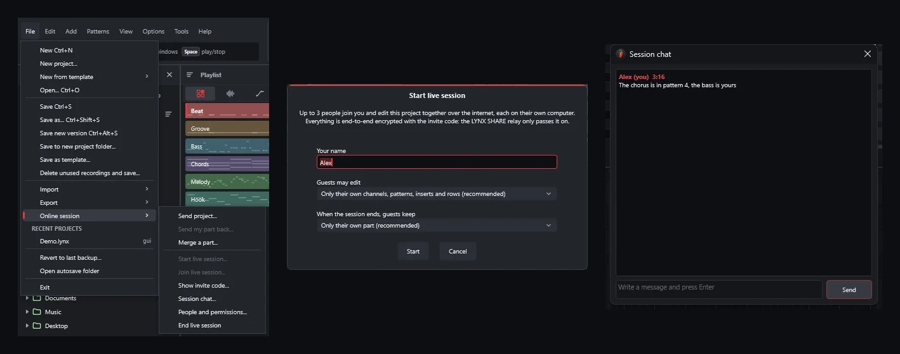

<p align="center">
  
</p>

<h1 align="center">LYNX SHARE</h1>

<p align="center"><strong>A lightweight DAW with FL Studio-style patterns and Ableton Live-style clips.</strong><br>
Free and open source, for Windows, macOS and Linux. Opens your FL Studio, Ableton Live and FL Studio Mobile projects.</p>

<p align="center">
  <a href="https://github.com/Ka1-S/LYNX-SHARE/releases"></a>
  <a href="https://apps.microsoft.com/detail/9NQRFBFDCX6N"></a>
  <a href="https://discord.gg/XHKkbtbkY"></a>
</p>

<p align="center">
  <a href="https://lynx-share.com"><strong>Website</strong></a> ·
  <a href="https://github.com/Ka1-S/LYNX-SHARE/releases"><strong>Download</strong></a> ·
  <a href="https://lynx-share.com/wiki/getting-started/">Getting started</a> ·
  <a href="#features">Features</a> ·
  <a href="#opens-your-projects">Your projects</a> ·
  <a href="#status-alpha">Status</a> ·
  <a href="https://discord.gg/XHKkbtbkY">Discord</a> ·
  <a href="#building">Build from source</a>
</p>

<p align="center">
  <a href="https://github.com/Ka1-S/LYNX-SHARE/actions/workflows/tests.yml"></a>
  
  
  
  <a href="LICENSE"></a>
  <a href="https://github.com/Ka1-S/LYNX-SHARE/releases"></a>
</p>

<p align="center">
  
  <br><sub>LYNX SHARE's own demo project: Browser, Playlist, Piano Roll, Channel Rack and Mixer.</sub>
</p>

---

## What is LYNX SHARE?

LYNX SHARE is a free, open-source digital audio workstation. Out of the box it works the way FL Studio does: you build
patterns in the **Channel Rack** and **Piano Roll**, arrange them in the **Playlist** and mix in the **Mixer**, with the
windows and shortcuts where you expect them. Two optional layouts sit one click away: a **Clip-launch** workflow with an
Ableton Live-style clip grid and scenes, and a **Simple** workflow, inspired by BandLab, for making a first song.

It opens FL Studio (`.flp`), Ableton Live (`.als`) and FL Studio Mobile (`.flm`) projects, and exports `.flp` and
`.als` back, so your work is not locked in. It is written from scratch in C++20 with JUCE 8, licensed under the
AGPL-3.0, and still an **alpha**.

**It's for you if you…**

- know FL Studio and want a free, open-source DAW that works the same way, on Windows, macOS or Linux;
- move projects between FL Studio, FL Studio Mobile and Ableton Live, or collaborate with people who use them;
- are making your first song and want one simple window to start in;
- have a modest computer and want a DAW that stays light.

## Why LYNX SHARE

| | |
|---|---|
| 🎹 **The FL Studio workflow** | Channel Rack, Piano Roll, Playlist with several arrangements, and a Mixer with inserts, sends and sidechain. The default layout, never watered down. |
| 📂 **Your projects come with you** | Opens `.flp`, `.als` (Live 11 and 12) and `.flm`; exports `.flp` and `.als`. FL Studio's native plugins play on LYNX SHARE's own engines, so a project that uses them plays without FL Studio installed. |
| 🎛️ **Three layouts, one program** | Patterns by default, a clip grid with scenes when you want to jam, or one simple window for a first song. Switch any time in *View › Layout style*. |
| 🤝 **Make music together** | Send a project to a friend as one file, or work on it live with up to three other people, end-to-end encrypted. |
| ⚡ **Lightweight** | A lock-free engine that spreads channels and mixer tracks across CPU cores, skips idle channels and streams long audio from disk. On one Windows PC it used 2.5–7× less RAM than FL Studio 2026 ([measurements](docs/analise/REA_rodada116.md), on an earlier version). |
| 🆓 **Free, open source, clean-room** | No price, no account, no subscription. Every behaviour was studied from the outside and written from scratch: no Image-Line or Ableton code is in it. |

## Features

### The pattern workflow (default)

<table>
<tr>
<td width="50%" valign="top">


**Channel Rack.** A step sequencer with per-channel volume, pan, mute and solo, swing, multiple patterns, cut groups,
an arpeggiator and the computer keyboard as a piano.

</td>
<td width="50%" valign="top">


**Piano Roll.** Snap, chords and scales, note colours and groups, slide and porta notes, quantize, velocity, pan and
pitch lanes, and MIDI import and export.

</td>
</tr>
<tr>
<td width="50%" valign="top">


**Playlist.** Pattern, audio and automation clips on tracks, several arrangements per project, markers and FL's clip
menu (split, chop, reverse, fit to tempo and more).

</td>
<td width="50%" valign="top">


**Mixer.** Up to 127 inserts with 10 effect slots each, sends, sidechain, delay compensation and smart disable, plus
any insert to any hardware output.

</td>
</tr>
</table>

### The Clip-launch workflow (optional)

<p align="center">
  
</p>

*View › Layout style › Clip-launch workflow* adds an Ableton Live-style clip grid next to the Playlist: tracks are
columns, scenes are rows. Clips have launch modes, quantisation and follow actions, and a selected clip opens in a Clip
View. Under the grid there is a Session mixer; there are also instrument, audio-effect and MIDI-effect racks, a Drum
Rack, Draw Mode and MIDI / Key Map Modes. Live sets bring their Session clips and scenes straight into the grid. The
pattern workflow stays the default, and nothing is taken away from it.

### The Simple workflow (optional)

*View › Layout style › Simple workflow* is one window with the tracks and the timeline, inspired by BandLab and
FL Studio Mobile. Add a voice, an instrument, a sampler or a starter beat in one click, shape the sound with eight
one-knob effects, play chords on a Chord pad and save the song as a file from the Finish dock. *Make my first song*
walks you through it step by step. The setup wizard offers all three layouts at the first start.

### Instruments and effects

<table>
<tr>
<td width="50%" valign="top">


**Instruments.** A three-oscillator synth, a sampler with slices and time-stretch, a SoundFont player, drums, a Drum
Rack, Slicex, FPC and DirectWave with FL Studio's editors, and engines for most of FL Studio's native synths.

</td>
<td width="50%" valign="top">


**Effects.** EQs, compressors, limiters, gates, reverbs, delays, modulation, saturation, pitch correction, a vocoder,
Edison (the audio editor) on any mixer slot, and Patcher for building your own chains.

</td>
</tr>
</table>

Every one of them is listed, with a picture of its editor, in the
[catalogue of instruments and effects](https://lynx-share.com/instruments-and-effects/).

### Everything else

- **Automation:** any knob or fader becomes an automation clip with points and curves (all 13 of FL's curve modes); MIDI controllers link to any parameter.
- **Recording:** notes from the computer keyboard or a MIDI keyboard, and audio with punch in/out, loop takes and comping.
- **Export:** WAV (16/24/32-bit float), MP3, FLAC and OGG; the song, one pattern, one file per marker section or stems; MIDI.
- **Third-party plugins:** VST3 and CLAP on every system, plus the formats in the table below. Plugins can run in a separate process, so one that crashes goes silent instead of taking your project down.
- **Online sessions:** *File › Online session* sends a project as one `.lynxpack` file, or starts a live session for up to four people.
- **And more:** themes, undo on every edit, autosave and project versions, freezing a channel to audio, MIDI controller profiles, and the interface in 15 languages.

<p align="center">
  
  <br><sub>Online sessions: the menu, starting a live session, and the session chat.</sub>
</p>

| | Windows 10 / 11 | macOS 11+ (Apple Silicon and Intel) | Linux x86_64 |
|---|---|---|---|
| **Plugin formats** | VST3, CLAP, VST2 (32-bit plugins through a bridge) | VST3, CLAP, Audio Units | VST3, CLAP, LV2, VST2 |
| **Audio drivers** | WASAPI, DirectSound, ASIO | Core Audio | PipeWire, JACK, ALSA |
| **Settings folder** | `%APPDATA%\LYNX` | `~/Library/Application Support/LYNX` | `~/.config/LYNX` |

## Opens your projects

*File › Open* (or a double-click in the Browser) takes `.lynx`, `.flp`, `.als`, `.flm` and MIDI files. Missing samples
are listed in the Missing files window, and *Help › Last project import report* tells you what was converted,
approximated or left out. The original file is never changed: saving writes a `.lynx` project.

| Format | Open | Export | In short |
|---|:---:|:---:|---|
| **FL Studio** `.flp` | ✅ | ✅ | Channels, samples, patterns, every arrangement, automation, the mixer and native plugins with their settings. |
| **Ableton Live** `.als` (Live 11 and 12) | ✅ | ✅ | Tracks, clips, warp markers, groups, returns, automation, racks and many of Live's devices. Session clips land in the clip grid. |
| **FL Studio Mobile** `.flm` | ✅ partial | — | Arrangement, samples, drum kits, several instruments and effects, automation and chord sets. |
| **MIDI** `.mid` | ✅ | ✅ | Notes, into or out of the Piano Roll or the whole song. |
| **LYNX SHARE** `.lynx` | ✅ | ✅ | The native format (JSON), with autosave. |

<details>
<summary><strong>FL Studio (<code>.flp</code>): what comes in and what goes back</strong></summary>

- **Structure:** channels, samples (including the Ogg Vorbis and WavPack files shipped with FL), patterns, slide and porta notes, every arrangement, markers, time-signature changes, automation and controller links.
- **Mixer:** routing, levels, sidechains, track EQ and native effects with their saved settings.
- **FL Studio's native plugins** play on LYNX SHARE's own engines, written from scratch and checked against the originals; most are exact or near-exact (see [Built-in plugins](#built-in-instruments-and-effects)). Wave data and factory sounds some of them need are read from *your* FL Studio installation, never shipped with LYNX SHARE.
- **Third-party plugins** inside the Fruity Wrapper are swapped for the same installed plugin, preset included.
- **Not opened:** FLEX packs are encrypted and are never opened; such a channel gets a built-in synth patch instead.
- **Export:** *File › Export › FL Studio project...* writes an FL Studio 2026 `.flp` (or a zip with the samples). What FL Studio has itself goes over as FL's own data; LYNX-only instruments and effects are rendered to audio first or replaced by the nearest FL plugin, and the report says which.

If FL Studio is installed on the same computer, `.flp` projects use the very plugin files FL uses and find samples in
FL's folders ([details](docs/FL_INTEGRATION.md)).

</details>

<details>
<summary><strong>Ableton Live (<code>.als</code>): what comes in and what goes back</strong></summary>

- **Import:** MIDI tracks become channels with their patterns, audio tracks become audio clips (warp markers and warp modes kept), groups and returns become mixer inserts and sends, plus tempo, time signature, locators, mixer levels and their automation. Session clips and scenes go into the clip grid with their launch settings and follow actions. Third-party VST2 and VST3 plugins keep their state and automation. Instrument and Audio Effect Racks come in with their chains and macros, and a Drum Rack becomes LYNX SHARE's Drum Rack.
- **Live's own devices** become LYNX SHARE's, with their settings and automation: EQ Eight, EQ Three, Channel EQ, Compressor, Glue Compressor, Multiband Dynamics, Limiter, Gate, Utility, Reverb, Delay, Echo, Auto Filter, Saturator, Overdrive, Chorus-Ensemble, Redux, Auto Pan and Drum Buss; Simpler, Sampler, Drift and Operator (without FM); the Arpeggiator, Pitch, Velocity, Chord and Note Length are written into the notes. Other devices are dropped and listed in the report.
- **Export:** *File › Export › Ableton Live set (.als)...* writes a set for Live 12 or Live 11 with the samples collected: tracks, clips, notes, warp markers, groups, returns, mixer, sends, automation, locators, racks, Drum Racks and the clip grid as Session view. Third-party plugins go over with their state; LYNX SHARE's own instruments and effects are not converted yet (the export report lists them).

More in the [format notes](docs/analise/ALS_FORMAT.md).

</details>

<details>
<summary><strong>FL Studio Mobile (<code>.flm</code>): import only, partial</strong></summary>

Tempo, time signature and the arrangement (note, drum and audio lanes), samples, drum kits with each pad's settings,
DW Sampler and DirectWave programs, the Slicer, the MiniSynth, Transistor Bass, 3x Osc, GMSynth and SuperSaw
instruments, FL Studio Mobile's effects, the mixer's levels, panning and routing, automation, chord sets and the key
locker. Other instruments play LYNX SHARE's built-in synth for now, and anything not converted is listed in the import
report. More in the [format notes](docs/analise/FLM_FORMAT.md).

</details>

## Built-in instruments and effects

LYNX SHARE's engines for FL Studio's native plugins are clean-room re-implementations, each compared against the
original. The plugins FL Studio users reach for most are all at *Exact* or *Near-exact* quality:

| LYNX SHARE engine | Compatible with | Status |
|---|---|---|
| 3x Osc engine | 3x Osc | Exact |
| FL Keys engine | FL Keys | Exact |
| Gross Beat | Gross Beat | Exact |
| Fruity Delay 3 | Fruity Delay 3 | Exact |
| Reeverb 2 | Fruity Reeverb 2 | Exact |
| Fruity Compressor | Fruity Compressor | Exact |
| Fruity Limiter | Fruity Limiter | Near-exact |
| Parametric EQ | Fruity Parametric EQ 2 | Near-exact |
| Soundgoodizer | Soundgoodizer | Near-exact |
| Maximus | Maximus | Near-exact |

**All of them:**

| | Exact | Near-exact | Close | Approximate | Placeholder |
|---|---:|---:|---:|---:|---:|
| **Generators** (3x Osc, DX10, Sytrus, Harmor, FL Keys, DirectWave, …) | 12 | 10 | 7 | 1 | 2 |
| **Effects** (Parametric EQ 2, Limiter, Reeverb 2, Delay 3, Gross Beat, Love Philter, …) | 34 | 10 | 1 | 8 | 1 |

*Exact* means bit-identical to the original in every case tested; *near-exact*, any difference is below about −100 dB;
*close*, the same algorithm within −60 dB. What each engine does and what it still lacks is in
[`docs/PLUGINS.md`](docs/PLUGINS.md). Plugin names are Image-Line's trademarks, used only to describe compatibility.

Many of LYNX SHARE's own effects are also available as CLAP plugins (a few as VST3) for use in other DAWs: an optional,
separate `LYNX-Plugins` download on the releases page (Windows and macOS in 0.1.27; the Linux pack follows later).

<!-- inspired:begin (generated by scripts/gen-inspired.py) -->
## Inspired by the classics

LYNX SHARE ships **native** plugins inspired by the third-party plugins producers use most, next to its clean-room FL Studio natives. 28 dedicated LYNX SHARE engines are in, more are being built, and a project that uses one of the 63 originals below **opens with the LYNX SHARE equivalent** when the original is not installed (its settings are kept and come back once it is; see [PLUGIN_FALLBACK.md](docs/PLUGIN_FALLBACK.md)).

| Vendor | Inspired by → LYNX SHARE plugin |
|---|---|
| **FabFilter** | Pro-L 2 → **Apex Limiter** · Pro-C 2 / 3 → **Crest Compressor** · Pro-MB → **Prism Multiband** · Pro-G → **Sentry Gate** · Pro-Q 2 / 3 / 4 → **Facet EQ** · Pro-DS → **Hush De-esser** · Saturn → **Ember Saturator** · Pro-R 2 → LuxeVerb (stand-in) · Timeless 3 → Fruity Delay 3 (stand-in) |
| **Valhalla DSP** | VintageVerb → **Epoch Verb** · Room → **Atrium** · Plate → **Foil Plate** · Supermassive → **Nebula** · Shimmer → **Halo** · FutureVerb → **Horizon** · Delay → **Echoform** · FreqEcho → **Spiral Echo** · SpaceModulator → **Orbit** · UberMod → **Lattice Mod** |
| **Antares** | Auto-Tune → **LYNX Tune** |
| **Waves** | H-Delay → **Echoform** · CLA-2A → **Glow Leveler** · CLA-76 → **Crest Compressor** · SSL E-Channel → **Ridge Strip** · S1 Imager → **Stereo Shaper** · DeEsser → **Hush De-esser** · NS1 → **Quell Denoiser** · Doubler → **Gemini Doubler** · Tune Real-Time → **LYNX Tune** · RVerb, H-Reverb, TrueVerb → Reeverb 2 (stand-in) · SuperTap → Fruity Delay 3 (stand-in) · L1, L2, L3, L4 → Limiter (stand-in) · Renaissance Compressor → Compressor (stand-in) · CLA-76, CLA-3A, C1, SSLComp, API-2500 → Compressor (stand-in) · Q10, Renaissance EQ, SSL EQ → Parametric EQ (stand-in) |
| **Solid State Logic** | Native Channel Strip, 4K E → **Ridge Strip** |
| **Soundtoys** | Little Plate → **Foil Plate** · EchoBoy → **Echoform** · PrimalTap → **Echoform** · Decapitator → **Ember Saturator** · Little AlterBoy → **LYNX Tune** · PanMan → Auto-pan (stand-in) |
| **Slate Digital** | Fresh Air → **Aether** |
| **Harrison** | 32Classic / MPC channel strips → **Ridge Strip** · De-Esser → **Hush De-esser** |
| **Complete Access (role)** | channel strips (Slate Virtual Mix Rack) → **Ridge Strip** · bus / smart compressors (SSL Bus Compressor 2, G3, VBC, sonible smart:comp, pure:comp) → **Crest Compressor** · optical levelers (Slate FG-2A, SD-3A, Custom Opto) → **Glow Leveler** · limiters (Slate FG-X 2, SSL X-Limit, sonible smart:limit, pure:limit) → **Apex Limiter** · EQs (Slate Infinity EQ, FG-73 / FG-N / FG-S / SD-PE1 / CS-EQ, Eiosis AirEQ, SSL X-EQ 2, sonible smart:EQ) → **Facet EQ** · de-essers (SSL DeEss, Slate FG-DS 902, Eiosis E2Deesser, sonible smart:deess) → **Hush De-esser** · gates (SSL X-Gate, Slate Gate Classic / Drums, Harrison Spectral Gate) → **Sentry Gate** · three-band bus compressor (SSL G3 MultiBusComp) → **Prism Multiband** · drum gate (Slate Gate Drums) → **Sentry Gate** · reverbs (LiquidSonics Lustrous Plates / Seventh Heaven / Cinematic Rooms, Slate VerbSuite Classics, SSL FlexVerb / PlateVerb / SpringVerb, sonible smart:reverb) → **Foil Plate** · delays (SSL X-Echo / X-Delay, Slate Stellar Echo SD-201, Harrison 3D Delay) → **Echoform** · saturators (Slate Heatwave / Revival, SSL Fusion Vintage Drive / X-Saturator, Harrison Tape Saturator) → **Ember Saturator** · pitch correction (Slate MetaTune) → **LYNX Tune** · vintage compressor models (Slate FG-116 / FG-76 / FG-401 / FG-A / FG-Dynamics, SSL X-ValveComp) → Compressor (stand-in) |
| **SPL** | Transient Designer → **Strike Shaper** |
| **Slate Digital (Complete Access)** | VCC Channel (console emulation) → **Kiln Channel** |
| **Solid State Logic (Complete Access)** | Drumstrip (drum channel strip) → **Shell Channel** · Guitarstrip (guitar / bass channel strip) → **Fret Channel** |
| **Image-Line FL Studio** | 76 natives at Exact / Near-exact quality: 3x Osc, FL Keys, Gross Beat, Fruity Limiter, Parametric EQ, Soundgoodizer, Maximus, Fruity Delay 3, Reeverb 2, Fruity Compressor, Epoch Verb, Nebula, Atrium, Foil Plate, Echoform, Crest Compressor, Prism Multiband, Sentry Gate … ([all of them](docs/PLUGINS.md)) |

<sub>Product and company names are trademarks of their respective owners. They are used only to describe compatibility and the role each LYNX SHARE engine plays. LYNX SHARE is not affiliated with, endorsed or sponsored by any of them and contains none of their code, presets, graphics or audio.</sub>
<!-- inspired:end -->

## Download

Get the latest build from the [releases page](https://github.com/Ka1-S/LYNX-SHARE/releases) or the
[download page](https://lynx-share.com/download/) (`<v>` is the version, e.g. `0.1.27-alpha`):

| System | File | Notes |
|---|---|---|
| **Windows** 10 / 11, 64-bit | `LYNX-<v>-setup-x64.exe` (installer) or `LYNX-<v>-windows-x64.zip` (portable) | Per-user installer, no admin rights. Also on the [Microsoft Store](https://apps.microsoft.com/detail/9NQRFBFDCX6N), which keeps it updated. |
| **macOS** 11 Big Sur or newer | `LYNX-<v>-macos-universal.dmg` | Universal: Apple Silicon and Intel. |
| **Linux** x86_64, glibc 2.35+ | `LYNX-<v>-x86_64.AppImage` or `LYNX-<v>-linux-x86_64.tar.gz` | Ubuntu 22.04+, Debian 12+, Fedora 36+, current Arch / Manjaro. |

Every file is built from the tagged source by GitHub Actions ([`release.yml`](.github/workflows/release.yml)) and
listed with its SHA-256 in `SHA256SUMS.txt`. Once installed, LYNX SHARE tells you when a new version is out.

<details>
<summary><strong>First launch on each system</strong></summary>

**Windows.** Run the installer, or extract the portable `.zip` and run `LYNX.exe`. The installer adds shortcuts, opens
`.lynx` projects and offers LYNX SHARE in *Open with* for `.flp` files without changing FL Studio's default. The
executable is not code-signed yet, so SmartScreen may warn the first time: choose *More info* → *Run anyway* (see
[Code signing policy](#code-signing-policy)).

**macOS.** Open the `.dmg` and drag LYNX SHARE to *Applications*. The app is not notarized by Apple yet, so the first
time right-click (Control-click) it → *Open* → *Open*. On macOS 15 Sequoia or newer, try to open it once, then go to
*System Settings* → *Privacy & Security* and click *Open Anyway*. Or, in Terminal:

```
xattr -dr com.apple.quarantine /Applications/LYNX.app
```

**Linux.** Needs X11 or XWayland; sound goes through PipeWire, JACK or ALSA ([details](docs/LINUX.md)).

```
chmod +x LYNX-*.AppImage
./LYNX-*.AppImage
```

Some distributions need libfuse2 for AppImages (`libfuse2` on Ubuntu 22.04, `libfuse2t64` on 24.04, `fuse2` on Arch,
`fuse-libs` on Fedora). Otherwise extract the `.tar.gz` and run `./install.sh`, which installs LYNX SHARE for your user
with a menu entry and the `.lynx` file type (`./install.sh --uninstall` removes it). The AppImage can update itself in
place with [Gear Lever](https://github.com/mijorus/gearlever) or AppImageUpdate.

</details>

## Getting started

1. **Install** LYNX SHARE (above) and open it.
2. **The setup wizard** picks the language, tests your audio device, lets you choose a layout and scans your plugin
   folders in the background: the standard VST3 and CLAP folders plus the ones FL Studio uses on the same computer. You
   can skip it and reopen it later from *Options › Setup wizard*.
3. **Open a project** with *File › Open*: one of yours (`.flp`, `.als`, `.flm`, MIDI), or the demo project
   (`Demo.lynx`, included with every download).
4. **Learn as you go** with the [wiki](https://lynx-share.com/wiki/):
   [Your first song](https://lynx-share.com/wiki/first-song/),
   [Coming from FL Studio](https://lynx-share.com/wiki/coming-from-fl-studio/),
   [Coming from Ableton Live](https://lynx-share.com/wiki/coming-from-ableton/) and the
   [Simple layout](https://lynx-share.com/wiki/simple-layout/).

**Handy shortcuts:** Space plays and pauses, F5 / F6 / F7 / F8 / F9 show the Playlist / Channel Rack / Piano Roll /
Browser / Mixer, L toggles Pattern / Song, and the keys `Z`…`M` and `Q`…`P` play the selected channel. The full list is
on the [Shortcuts](https://lynx-share.com/wiki/shortcuts/) page.

<details>
<summary><strong>Command line</strong></summary>

LYNX SHARE also runs without a window, to render and convert projects. On macOS and Linux the binary is `LYNX`
(`/Applications/LYNX.app/Contents/MacOS/LYNX` on macOS); the options are the same:

```
LYNX.exe project.lynx                          open a project (.lynx, .flp, .als, .flm or .mid)
LYNX.exe --export project.flp out.flac         render the song (wav/flac/ogg)
LYNX.exe --render project.flp out.wav 20       render 20 s of the current pattern (24-bit WAV)
LYNX.exe --export-flp project.lynx out.flp     export an FL Studio project (.zip: with the samples)
LYNX.exe --export-als project.flp folder [--live11]  export an Ableton Live set (<name> Project/<name>.als)
LYNX.exe --selftest report.txt [demo.lynx]     self-test without an audio device
LYNX.exe --snapshot prefix project.flp         draw the UI (and its windows) to PNG
LYNX.exe --showcase out.lynx [pattern]         generate the demo project used in these screenshots
LYNX.exe --plugintest plugin.vst3 rep.txt      test a VST3 or CLAP plugin
LYNX.exe --sandboxtest plugin.vst3 rep.txt     test a plugin in a separate process (including a hung one)
LYNX.exe --scantest folder rep.txt             scan a folder for plugins (separate processes)
LYNX.exe --fldb rep.txt [project.flp] [--scan] FL Studio found here, its plugin database, a project's plugin matches
LYNX.exe --devices rep.txt                     list audio drivers and outputs
LYNX.exe --devicetest "ASIO" "driver" rep.txt  open a driver for 1 s of silence and report it
LYNX --uiperf project.flp rep.txt              time the UI drawing: Mixer, Playlist, Channel Rack, playing and scrolling
LYNX.AppImage --menu-entry on|off              Linux AppImage: add to / remove from the applications menu
```

</details>

## LYNX Remote Control (experimental)

Enable **Settings > General > Remote control** to let authenticated local clients read and edit the open project. It is off by default. An active indicator appears under the toolbar; switching the setting off closes the listener and removes its discovery file. Automatic update checks keep their normal behavior.

The vendor-neutral `lynx-control/1` API provides bounded project and device reads, complete paged native-project snapshots, atomic document edits, transport, revision/change tracking and guarded native undo. It uses an owner-private discovery file and mutual authentication on loopback. Windows, macOS and Linux use the same protocol. This API is not in a released build yet.

See the [protocol and operation reference](docs/REMOTE_CONTROL.md) and [standalone Python client](examples/remote_control.py). For unattended launches, `LYNX_CONTROL_ENABLED=1` enables the API for that run; `LYNX_CONTROL_DISCOVERY` optionally selects an absolute private discovery path. The path alone does not enable remote control. Keep discovery credentials out of chat, version control and shared folders.

## Status: alpha

LYNX SHARE already opens, plays and exports whole projects, and new releases come out often. It is not yet a
replacement for the DAW you rely on every day: expect bugs, save often and keep backups. What is still missing or
rough today:

- Not every FL Studio plugin sounds exactly like the original; [`docs/PLUGINS.md`](docs/PLUGINS.md) gives each one a status, from exact to approximate.
- Only some of Live's own devices are converted from `.als` sets, and LYNX SHARE's own instruments and effects are not written into exported sets yet.
- `.flm` import is partial, and FL Studio Mobile projects cannot be exported.
- The Windows build is not code-signed and the macOS build is not notarized yet, so both systems warn the first time. The macOS build has had little testing on real Macs.

Each release's notes list its known issues. The details are in [`docs/STATUS.md`](docs/STATUS.md) (what works, what
is approximated, what is missing) and the plan in [`docs/ROADMAP.md`](docs/ROADMAP.md).

## Community and contributing

- **Discord:** [discord.gg/XHKkbtbkY](https://discord.gg/XHKkbtbkY) for chat, help, feedback and release announcements.
- **Bugs and ideas:** open an [issue](https://github.com/Ka1-S/LYNX-SHARE/issues/new/choose) (*Bug report*, *Feature request* or *Sound / plugin difference*). Several fixes in recent releases started as user reports.
- **Pull requests** are welcome: read [`CONTRIBUTING.md`](CONTRIBUTING.md) first, including the clean-room rule.
- **Radiant** ([Kenneth-Cho-InfoSec/Radiant](https://github.com/Kenneth-Cho-InfoSec/Radiant)) is an independent, unofficial Android adaptation of LYNX SHARE for tablets and phones. It is a separate community project, not maintained or reviewed by us.

## Support LYNX SHARE

LYNX SHARE is free and stays free. If you would like to support its development, you can do so on
[Ko-fi](https://ko-fi.com/lynxshare). It is entirely optional and never unlocks anything: every feature is the same
for everyone. Reporting bugs, sharing your music made with LYNX SHARE and telling a friend help just as much.

## Building

Short version below; [`docs/SETUP_DEV.md`](docs/SETUP_DEV.md) has the full development setup.

**Windows from WSL / Linux, without Visual Studio (Zig).** Needs Zig 0.14.1 in `~/opt/zig-x86_64-linux-0.14.1` and
JUCE 8.0.4 in `~/opt/juce-8.0.4` (or set `ZIG` and `JUCE_DIR`). JUCE 8 does not officially support MinGW; the script
works around the differences (see `cmake/mingw/` and `src/platform/MingwFixes.cpp`).

```
./scripts/build-windows-zig.sh      # produces build-win/LYNX.exe
```

**Windows with Visual Studio.** Needs Visual Studio 2022 Build Tools ("Desktop development with C++"), CMake 3.22 or
newer and Git.

```
cmake -B build -G "Visual Studio 17 2022" -A x64
cmake --build build --config Release
```

**Linux** (Ubuntu 24.04 packages):

```
sudo apt install build-essential cmake ninja-build pkg-config libasound2-dev libjack-jackd2-dev libx11-dev \
  libxrandr-dev libxinerama-dev libxcursor-dev libxext-dev libxcomposite-dev libfreetype-dev libfontconfig1-dev libgl-dev
cmake -S . -B build -G Ninja -DCMAKE_BUILD_TYPE=Release
cmake --build build
```

**macOS.** Needs the Xcode command line tools (`xcode-select --install`), CMake and Ninja (e.g. `brew install cmake
ninja`). Leave out `CMAKE_OSX_ARCHITECTURES` to build for the current Mac only.

```
cmake -S . -B build -G Ninja -DCMAKE_BUILD_TYPE=Release -DCMAKE_OSX_ARCHITECTURES="arm64;x86_64"
cmake --build build
```

**Core tests** (any C++20 compiler, no JUCE). More than a million checks, including parsing the projects that ship
with FL Studio when you pass their folder. `LYNX_TEST_JOBS=auto` runs them in parallel; the test binary also takes
`--list`, `--filter a,b`, `--exclude a,b` and `--shard i/n`.

```
./scripts/build-local.sh ["folder with .flp files"]
```

<details>
<summary><strong>Under the hood</strong></summary>

```
src/core/     model, sequencer, instruments, effects and .flp import (plain C++, testable without JUCE)
src/flp/      .flp format reader
src/engine/   audio engine (JUCE): device, graph, samples, plugins, project files
src/ui/       UI: Channel Rack, Piano Roll, Playlist, Mixer, windows
third_party/  CLAP (MIT) and the WavPack decoder (BSD)
tests/        core tests
tools/        flpdump, renderwav, comparewav, make_logo
docs/         architecture, status, roadmap and notes on FL Studio's behaviour
```

- **Lock-free audio:** the UI edits a copy of the song and hands an immutable snapshot to the audio thread.
- **Sample-accurate rendering:** every note lands on its exact sample; mixer tracks are processed in parallel layers.
- **Isolated plugins:** plugin scanning always runs in separate processes, and the plugins themselves can too.

</details>

### Documentation

| Document | Contents |
|---|---|
| [`docs/STATUS.md`](docs/STATUS.md) | what works, what is approximated and what is missing |
| [`docs/PLUGINS.md`](docs/PLUGINS.md) | the built-in plugins, what each one is compatible with, and its status |
| [`docs/USER_GUIDE.md`](docs/USER_GUIDE.md) | LYNX SHARE's own features, beyond the FL Studio workflow |
| [`docs/ROADMAP.md`](docs/ROADMAP.md) | project phases |
| [`docs/ARCHITECTURE.md`](docs/ARCHITECTURE.md) | how the engine and the UI are organised |
| [`docs/CODE_SIGNING.md`](docs/CODE_SIGNING.md) | how releases are built and code-signed |
| [`PRIVACY.md`](PRIVACY.md) | privacy policy: every network connection LYNX SHARE makes, and why |
| [`docs/MANUAL_TESTING.md`](docs/MANUAL_TESTING.md) | a script for checking by ear and by hand what the automated tests don't cover |
| [`docs/analise/`](docs/analise) | clean-room notes on FL Studio's and Live's behaviour and file formats |

Some of the older notes are still in Portuguese and are being translated.

## Support LYNX SHARE

LYNX SHARE is free and open source, made by an independent developer. If it helps your music, you can support it on
[Ko-fi](https://ko-fi.com/lynxshare). Donations keep the project going: they pay for the server (VPS) behind sharing,
the relay and the tests, the AI tools and tokens used in development, the website, the Apple developer account for
signed Mac builds, and the reference plugins used to check the sound quality. Donating is optional and never unlocks
anything: everything in LYNX SHARE stays free for everyone. In the app: Help › Support LYNX SHARE...

## Credits and notice

LYNX SHARE is an independent implementation. FL Studio, FL Studio Mobile and Ableton Live were studied only to
understand their behaviour and file formats; no Image-Line or Ableton code was copied, and no protected content (such
as FLEX packs) is ever opened.

FL Studio and FL Studio Mobile are trademarks of Image-Line Software; Ableton and Live are trademarks of Ableton AG;
BandLab is a trademark of BandLab Technologies. LYNX SHARE is not affiliated with, endorsed or sponsored by any of
them. VST is a registered trademark of Steinberg Media Technologies GmbH.

Logo by **w3teal**.

Built with [JUCE](https://juce.com), [CLAP](https://github.com/free-audio/clap), the [WavPack](https://www.wavpack.com)
decoder and the Steinberg ASIO SDK; their licences are listed in [`THIRD_PARTY.md`](THIRD_PARTY.md). Thanks to everyone
who reported bugs and sent pull requests.

## Code signing policy

Free code signing provided by [SignPath.io](https://about.signpath.io), certificate by
[SignPath Foundation](https://signpath.org). *(Pending approval: until the application is accepted, release
binaries are not signed.)* This covers the Windows binaries. The macOS app has an ad-hoc signature only (no Apple
Developer ID, not notarized); Linux packages are not signed.

- Release binaries are built only from this repository by GitHub Actions
  ([`.github/workflows/release.yml`](.github/workflows/release.yml)); nothing built on a personal machine is signed.
- Every signing request is approved manually for each release.
- Team roles:
  - Committers and reviewers ("Authors" and "Reviewers"): [Ka1-S](https://github.com/Ka1-S)
  - Approvers: [Ka1-S](https://github.com/Ka1-S)

**Privacy:** This program will not transfer any information to other networked systems unless specifically
requested by the user or the person installing or operating it. See [`PRIVACY.md`](PRIVACY.md).

**Crash reports (opt-in):** after a crash or freeze LYNX SHARE asks before sending a report to lynx-share.com (*Send* /
*Show what will be sent* / *Don't send*, or *Report on GitHub instead*); *Settings › General › Crash reports* sets
*Ask* (default), *Always send* or *Never send*. A report has the LYNX SHARE version, OS, CPU, graphics card and driver,
audio device, the crash or freeze file, the last steps and the loaded third-party plugins: no audio, projects, file
names, user or machine name, and the server stores no IP address. Details and how to have a report deleted:
[`PRIVACY.md`](PRIVACY.md#crash-reports-opt-in).

## License

LYNX SHARE is free software under the [GNU Affero General Public License v3.0](LICENSE): you may use, study, modify and
redistribute it; anyone who distributes a modified version (including as a network service) must publish its source
code under the same license.

<p align="center">
  <a href="https://star-history.com/#Ka1-S/LYNX-SHARE&Date">
    
  </a>
</p>
